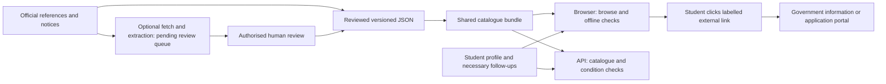

# SchemeMatch: current data flow and verification status

Updated 10 October 2026. This describes the active vanilla JavaScript/Express app, not the unused React scaffolding or presentation artifacts.

## Where programmes come from

The app does **not** query every government portal when a student opens it. It publishes a versioned directory prepared from official references:

| Source file | Content | Count |
|---|---|---:|
| `frontend/src/data/state-scholarships.json` | Student programmes/programme families in the approved states | 77 |
| `frontend/src/data/central-scholarships.json` | Named central scholarships listed on NSP | 31 |
| `frontend/src/data/other-schemes.json` | Agriculture, health, social security, financial inclusion, livelihood, energy and housing | 12 |

`npm run catalog:build` validates IDs, official source/application routes and information-only controls, then generates `frontend/src/js/scheme-catalog.js`. The browser loads that committed bundle directly, so directory availability does not depend on MongoDB, scraping or a successful JSON fetch. `backend/src/data/catalog.js` imports the same module for API, chat and ingestion. `npm run catalog:check` prevents an outdated generated bundle from passing validation.

The bundle has a content-based SHA-256 version shared by the API and browser. The browser rejects outdated or malformed matching responses and awards for records whose full rules are still pending, then uses its local condition checks. Restarting an older server cannot silently restore its unreviewed match scores.

The approved states are Tamil Nadu, Maharashtra, West Bengal, Rajasthan, Gujarat, Odisha, Kerala, Telangana, Andhra Pradesh, Bihar, Haryana, Jharkhand, Chhattisgarh, Uttar Pradesh and Assam. These are selected-state coverage, not complete coverage of all Indian states, all programmes or every category within a state. Central programmes have their own programme-specific restrictions; “Central” does not mean every Indian student qualifies.

An external link opens the URL saved against that programme's stable ID. It does not download a new programme, send the student's form to government, authenticate the student, submit an application or confirm an award. Source and application links are separate. Missing application routes do not fall back to NSP. Cards no longer redirect when their backgrounds are clicked.

Before this change, frontend and backend maintained different national/Tamil Nadu rule arrays. Offline best-fit used the Tamil Nadu array alone, discovery was Tamil Nadu-only, and name aliases could override a card's own application route. The active directory now replaces those legacy records. Legacy functions remain for regression work; their unreviewed scores and amounts are not published as current eligibility decisions.

## Verification means separate things

| Check | Current status |
|---|---|
| Official programme reference/ownership route | Recorded per listing, with the source-check date |
| Published screening rules | Seven central records enabled; other records remain partial or pending. Passing self-declared checks does not guarantee selection. |
| Necessary conditions | Shared checks for TN BC/MBC/DNC college assistance, Maharashtra SC, Gujarat SC, Haryana SC/BC and PM-USP CSSS |
| Application window | Only source-specific published windows are displayed; other windows remain unknown |
| Portal reachable/login/submission | Recorded separately in access notes; no applicant login or submission was tested |
| Beneficiary/public endorsement | Not independently verified; reviews and government aggregate claims are not proof of a particular applicant's experience |

Current results distinguish location/course relevance, missing information, failed reviewed conditions, and meeting reviewed conditions with full review pending. Unknown facts remain unknown. The app asks additional facts only for relevant reviewed checks, reuses saved answers, allows corrections and suppresses questions after a known exclusion. It does not infer Haryana BC from OBC or board percentile from percentage marks.

The [current NSP catalogue](https://scholarships.gov.in/All-Scholarships) was readable on 9 October 2026. It publishes CSSS's 2026–27 closing date as a **renewal** window; fresh opening was not confirmed. CSSS's [guideline linked by NSP](https://scholarships.gov.in/public/schemeGuidelines/CSSS_GUIDLINES_07022024_updated.pdf) separates fresh board-percentile requirements from annual examination/attendance checks for renewal. An older scanned guideline encountered at a recently uploaded government URL contained obsolete rates; it was not used to activate current rules. Upload date is not a policy version.

## Record and database structure

| Field group | Fields and purpose |
|---|---|
| Identity/scope | `id`, `name`, `state` (absent for central), `sector`, `type`, `by`, `department`, optional `audience` |
| Source evidence | `source`, `sourceChecked`, `sourceVerification`, `verificationScope`, `evidenceSummary` |
| Application route | `applicationUrl` (nullable), `portal`, `accessNote`, `applicationRoute` |
| Window | `academicYear`, `deadline`, `deadlineVerified`, `deadlineSource`, `deadlineChecked`, `status` |
| Rules | `reviewedConditions` with source/date, category/course gates, checks, operator, field and reason |
| Decision controls | `matchingEnabled:false` until reviewed screening rules are complete; seven central records now enabled |
| Benefits/documents | Descriptive `amt`, `amtNum:0` for unreviewed awards, optional `benefitVerified`/`benefitSource`, `documentsVerified`, `documentsNote` |
| Public usage | `beneficiaryVerification:not-independently-verified` |

MongoDB `User` stores accounts and self-declared profile/follow-up facts. It does not validate government certificates. `Scheme` can mirror the directory through the seed script; older Mongo records do not override the published bundle. `SchemeChangeProposal` stores source URL/final URL, SHA-256 hash, bounded source excerpt, fetch/extraction outcome, pending/approved/rejected status, trusted reviewer ID, date and review note. Reviewing a proposal records the review; publishing accepted facts requires a versioned JSON edit/build. Full rule approval is a separate obligation.

Ingestion endpoints require JWT authentication, a database-granted `scheme-reviewer` role and `SCHEME_REVIEWER_EMAILS`. A client-provided role or reviewer name cannot grant access. The source registry includes all 120 records across the 15 states. Every redirect is checked against the official-domain policy. High AI confidence remains pending. Failed, truncated and scanned/low-text sources cannot silently publish facts. Daily ingestion is opt-in via `INGESTION_ENABLED=true`, at 03:00 Asia/Kolkata in the persistent server; no background cron runs in serverless functions.

## Fixed behaviour

State-plus-central browsing is the default. Without a state, broad browsing distributes the first records across states; all-state browsing remains available. Students are the default sector, with separate other-sector/all-sector options. Information listings remain visible in eligibility results even when no final eligibility decision is possible.

Unsupported benefit totals, caste/gender benefit multipliers, blanket “no deadline” labels, old news/exam dates, fictitious match weights and assumed document procedures were removed from active views. Dashboard counts and published deadlines come from the directory. College figures without reviewed sources are withheld. Source links are escaped and checked; tracker links reject executable URLs. Tracking stages are user-reported, not government verification.

Local development uses API port 5050. Production defaults to `/api/v1`; `frontend/src/js/config.js` can point a separate frontend at an HTTPS API. The repository-root Vercel entry includes the shared catalogue. Deploy from the root for this configuration. Deployment was not performed or verified against a live host.

## Credentials and restarting

The Atlas credentials were repaired with the hidden-input helper. The backend was restarted. Registration, login, profile reload and saved-scheme persistence passed a temporary-account check, including the new scholarship fields; the test account was removed. A new cluster is unnecessary for these changes. Hosted deployments still require their own server-side environment settings. The following steps remain the repair procedure if credentials change again.

1. In Atlas, open **Database Users**, edit the app's database user and set a valid password. Atlas website login credentials are different from database-user credentials. See [MongoDB's official instructions](https://www.mongodb.com/docs/atlas/security-add-mongodb-users/).
2. From the repository root, run `npm run db:configure` in your own Terminal. Inputs are hidden. Enter can reuse the configured cluster and URI username; the script encodes a newly entered password.
3. The script performs a read-only connection/ping before updating `.env` and `backend/.env`, preserving unrelated settings. It does not create or delete database records. Failed authentication leaves settings unchanged.
4. After successful setup, restart the backend with `npm run backend` and frontend with `npm start`, or ask Codex to restart and retest the existing local processes. Hosted environments require their own secret settings and a redeployment/restart.

Do not send database passwords or full connection strings through chat. [MongoDB troubleshooting](https://www.mongodb.com/docs/atlas/troubleshoot-connection/) explains password encoding and network access if the new connection still fails.

## Evaluation and remaining work

Automated fixtures cover parsing negation/corrected income, unknown facts, boundaries, state relevance, conditional follow-ups, duplicate catalogue IDs, browser/API parity, unsafe URLs, redirect rejection, restricted review, spoofed reviewer identities and non-publication of high-confidence extraction. Headless browser checks cover all 15 state filters with at least four student listings each, 31 central scholarship cards, 12 other-sector cards, saved follow-ups, a backend outage, calendar filters, desktop/mobile rendering and simulated speech events. These tests establish behaviour for the fixtures, not population eligibility accuracy or real-language speech accuracy.

Latest local validation: **131 automated tests passed, zero failed**; catalogue/calendar browser checks passed with no JavaScript errors or mobile horizontal overflow. A separate real Google Translate check successfully translated the Kannada landing page, kept SchemeMatch unchanged, showed no desktop/mobile overflow and reapplied the saved selection after reload. Other provider attempts failed or timed out; translation is external and intermittent, and the UI does not report confirmation merely because the provider accepts an option. Language quality has not had human review. The API was restarted and serves all 120 records with the current catalogue version. MongoDB account persistence passed after credentials were updated through the local helper.

## Public NSP import and calendar expansion

The public NSP catalogue scrape captured 176 distinct listings across central, sponsored and all 24 advertised state/UT filters, with no failed filters. `docs/evidence/nsp-catalogue.snapshot.json` stores the published names, department, academic year, fresh/renewal route, student deadline, separate officer-verification dates, guideline/FAQ URLs and page hashes. It excludes academic-year headings. Applicant accounts and linked PDF contents are outside this scrape. `npm run nsp:scrape` refreshes the evidence snapshot; `npm run nsp:import` explicitly imports a complete snapshot into the existing JSON structure, keeping only the approved 15 states and central programmes. Existing aliases are merged; overlapping umbrella listings are skipped. Run `npm run catalog:build` after inspecting imports. Full rules outside the seven reviewed central records remain pending.

`frontend/src/data/exam-calendar.json` contains 42 organiser references covering the 15 states and national examinations. `npm run exams:build` generates the browser/ES-module-compatible bundle; `npm run exams:check` verifies it. Ten national entries have upcoming published 2027 dates as of this review, two Tamil Nadu entries retain past 2026 schedules, and the remaining references leave the next date unconfirmed. Source ownership and schedule verification are separate. Telangana counselling pages establish programme identity; reporting dates are not used as entrance examination dates. Academic organiser exceptions use exact hosts and do not widen the scholarship URL policy. Countdown calculations use Indian dates and the next remaining exam day.

Remaining requirements are full current guideline/GO review and rule implementation outside the seven enabled central records, further state-specific fresh/renewal documents and course/year benefit calculations, confirmed coexistence permissions, real applicant portal access testing without submission, real microphone samples for the existing 11 language options, a labelled evaluation dataset and a production deployment check. Source ownership does not fill these gaps. Scanned PDFs need manual reading or an independently validated OCR workflow; OCR is not wired into automatic ingestion.

The existing selector is English plus ten Indian languages, 11 total. Recognition still depends on browser/OS speech support; selecting a locale does not prove that provider supports it. No expansion to 22 scheduled languages or paid speech provider was made.

See [Verified rules and deployment](VERIFIED_RULES_AND_DEPLOYMENT.md) for the reviewed seven-record scope, Telangana preparation/overseas limits, working Education News cards, annual estimates and one-project deployment guide.
