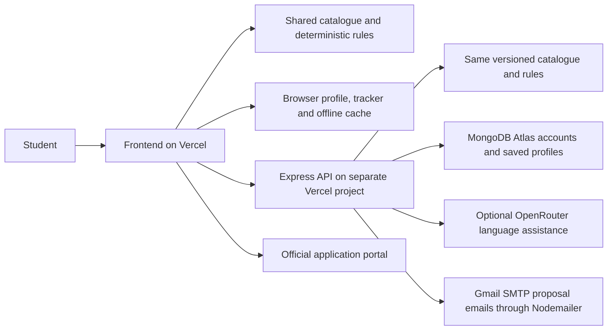
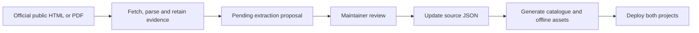

# SchemeMatch: prototype pitch and demonstration guide

Updated **10 October 2026** for the deployed prototype. This guide replaces the older implementation snapshot. Start with the spoken pitch and demo; use the technical explanations and Q&A when judges ask for detail.

**The sentence to remember:**

> SchemeMatch helps students turn their saved profile into relevant scholarship options, explained screening checks and a step-by-step preparation plan.

## 1. Open the actual prototype

| What to open | Link | Purpose |
|---|---|---|
| Student website | [SchemeMatch](https://schemematch-rosy.vercel.app) | Your main presentation and live demo |
| Backend health | [API health check](https://schemematch-api.vercel.app/health) | Check that the API responds |
| Public catalogue | [Catalogue API](https://schemematch-api.vercel.app/api/v1/schemes) | Technical evidence of the published data |

The frontend and backend are **two separate Vercel projects**, connected to the existing MongoDB Atlas cluster. The website serves the interface and public catalogue. The API handles account persistence and online services. Registration, login and profile persistence were also checked after deployment; a health response alone does not prove the database works.

Present SchemeMatch as a working independent prototype. Government portals remain responsible for applications, certificate checks, selection and payment. Application buttons distinguish direct forms, registration and applicant login; schemes without a confirmed public form explain their available route. See [APPLICATION_FORM_ROUTES.md](APPLICATION_FORM_ROUTES.md) for the current audit.

## 2. The problem, user and product story

A student knows their course, category, state and family income, but scholarship information is spread across portals, notices and PDFs. Finding a programme is only the first step: the student must understand its application route, missing conditions, documents and deadline.

**Problem statement:** How can we help a student identify relevant educational support and understand the next preparation step from one saved profile?

The primary user is an Indian student seeking state or central educational support. For the demo, use a first-year technical student from Telangana. College scholarship support teams are a possible future pilot partner; an institutional rollout is not already established.

The journey has four steps:

1. **Discover:** save a profile and see relevant programmes, highest profile match first.
2. **Understand:** inspect supported conditions and answer programme-specific questions.
3. **Prepare:** work through documents, with help for anything missing.
4. **Organise:** track preparation and see published upcoming deadlines.

The cached public catalogue and local checks also help students continue after a connection drop. The intended value is less searching and a clearer next action. Time saved, applications completed and funding received have not yet been measured in a student pilot.

## 3. Your ready-to-speak pitch

### Short introduction: about one minute

> Good morning. A student can be a suitable candidate for educational support and still struggle to find the right programme or understand what to prepare. Scholarship information is spread across portals, guidelines and notices.
>
> We built SchemeMatch to bring discovery and preparation into one student journey. The student saves a profile, receives ranked scholarship suggestions, checks supported programme conditions and prepares documents through a guided conversation. If the profile changes, the recommendations change with it.
>
> Our deployed prototype contains 120 programme listings, coverage across 15 states and seven central records with enabled screening and annual-rate logic. It also supports cached offline browsing and local checks.
>
> AI helps with profile interpretation and explanations. Shared deterministic rules calculate the results. The percentage measures profile relevance; the authority still decides eligibility and awards. Let me demonstrate it with a fictional student from Telangana.

### Main pitch: about three minutes

> Good morning. Imagine a student starting college who needs financial support. They know their course and family income, but not which scholarship to search for. Even after finding one, they may be unsure about the conditions, documents and application deadline. Information is spread across different portals and guidelines.
>
> We built SchemeMatch to make that journey easier to navigate. It starts with one saved student profile. The student can fill a form or describe their situation naturally, review the information and receive relevant scholarship suggestions.
>
> Let us take Ananya, our fictional demo student: a first-year technical student from Telangana. In Find my schemes, she sees ranked programmes with profile match percentages. Those percentages describe how well the available programme audience fits her saved details. When we change her category or course, the recommendations refresh across the dashboard, results and assistant.
>
> A relevant suggestion is followed by a separate screening step. For supported programmes, we ask the additional questions that matter, such as institution approval or application route. Published annual rates are shown separately from a personal estimate. We then guide Ananya through the preparation documents, one at a time. A green tick records her confirmation that a document is ready.
>
> She can track the programme, check the nearest published deadline and open the official portal when ready. After a successful online visit, the public catalogue and local checks remain usable through a cached offline reload.
>
> The prototype is live as separate frontend and backend projects on Vercel, with MongoDB for account profiles and saved programme IDs. It includes 120 programme listings, coverage for 15 states and seven central records with enabled screening and annual-rate logic. Browser and backend share the same versioned catalogue and rules. AI assists interpretation and phrasing; deterministic code calculates the matches and supported checks.
>
> Our validation includes 150 passing regression tests and hosted checks for accounts, profile changes, six assistant match cards, mobile layout and offline reload. Our next step is to review more programmes and run a student pilot, measuring whether students reach the correct official source and understand their next action with less effort. Thank you.

Rehearse at your natural speaking pace. If the demo is included in a three-minute round, use the short introduction and the abbreviated flow in section 5.

## 4. Prepare one convincing demo

Use the deployed website in a dedicated browser session. Enter fictional details through the normal controls. The core journey works as a guest; login is an optional supporting demonstration.

| Profile field | Fictional demo answer |
|---|---|
| Name | Ananya Demo |
| Age | 18 |
| State | Telangana |
| Category | SC |
| Education | Undergraduate technical degree / BTech |
| Course year | First year |
| Annual family income | ₹80,000 / below ₹1 lakh |
| Gender | Female |
| Disability | No |

Save the profile before asking for suggestions. Review autofilled fields rather than assuming the description populated every answer. A useful description is:

> My name is Ananya. I am an 18-year-old female first-year BTech student from Telangana, in the SC category. My annual family income is ₹80,000. I do not have a disability.

### Rehearsed screening example

Choose **AICTE Pragati — Technical Degree** to demonstrate the difference between a profile match and supported screening. These fictional answers fit the implemented fresh-application example:

| Additional question | Demo answer |
|---|---|
| Fresh application or renewal | Fresh |
| Course and institution AICTE approved | Yes |
| Regular technical course | Yes |
| Dual-degree course | No |
| Other financial assistance | No |
| Current course year | 1 |
| Admission route | First-year admission |
| Gap between qualifying examination and admission | 0 years |
| Girl beneficiaries in family | 1 |

Follow the labels in the actual UI and answer remaining applicable questions. Keep unknown fields unanswered outside this fictional demonstration. With supported checks passing, this example can show **₹50,000/year if selected**. This is an implemented calculation, not an approved award.

The hosted browser check observed **89%, 88%, 88%, 88%, 81%, 81%** on six assistant cards for a saved test profile. These are an example, not fixed scores to promise. Additional saved answers can change scores and ordering.

### Before going on stage

- Open the live site and save the fictional profile.
- Ask **Find my schemes** and confirm the percentage cards appear.
- Locate Pragati; rehearse its checks and document guidance.
- Change one meaningful profile field, observe refreshed suggestions, then restore the demo profile.
- Inspect the nearest published notice in Deadlines.
- For offline demonstration, visit online first, allow the service worker to activate, then rehearse a network-disabled reload.
- Keep screenshots and a typed profile as backup. Rehearse voice or translation separately on your presentation device if you intend to show them.

Do not enter genuine Aadhaar numbers, bank numbers, passwords or identity documents in the demo chat. The document flow asks about readiness, not those numbers.

## 5. Seven-minute demo: action and speaking line

| Time | Action | What to say |
|---|---|---|
| 0:00–0:40 | Landing page and student problem | “We help a student discover relevant support and understand what to do next.” |
| 0:40–1:20 | Review and save Ananya's profile | “The student can enter details naturally or use the form, then correct what we understood.” |
| 1:20–2:10 | AI Assistant → **Find my schemes** | “The best profile matches appear first. This percentage measures relevance from saved information.” |
| 2:10–2:45 | Change SC to ST, or technical degree to school level; save and restore | “One profile edit updates the dashboard, browsing, results and assistant. Known incompatible audiences are excluded.” |
| 2:45–3:45 | Pragati → **Check eligibility**; expand additional questions | “This programme needs facts the basic profile doesn't establish. Deterministic rules evaluate those answers.” |
| 3:45–4:35 | **Guide me**; confirm one document, request help for another | “The assistant asks about one document at a time. This tick means Confirmed by you.” |
| 4:35–5:10 | **Track** → Application Tracker; then Deadlines | “The student keeps a preparation record and sees the nearest published closing date.” |
| 5:10–5:45 | Show mobile layout or rehearsed offline reload | “Once cached online, the public catalogue and local checks can continue offline.” |
| 5:45–6:25 | Architecture from section 7 | “The browser and API share catalogue and rules. MongoDB saves account data. AI assists interpretation and wording.” |
| 6:25–7:00 | Evidence and next step | “We passed 150 regression tests and hosted account and browser checks. Next, we will review more programmes and evaluate with students.” |

**Dated deadline example:** on 10 October 2026, the tested demo showed GATE's extended late-fee registration closing on **12 October 2026**, two days away. At a later event, show the nearest upcoming notice the app actually displays. Do not repeat an expired countdown.

For a **three-minute total round**, use the short introduction, saved profile, Find my schemes, one profile change and one document tick. Finish with validation and the next step. Leave extra panels for questions.

### If a live dependency fails

| Issue | Continue with |
|---|---|
| Microphone or recognition fails | Prepared typed description or form |
| Translation cannot load | English interface; explain the external provider dependency |
| Online AI times out | Local catalogue answers and deterministic checks |
| Account API is unavailable | Guest profile and saved evidence of persistence |
| Network drops after caching | Rehearsed offline reload and local matching |
| Government destination is unavailable | Stored programme information and source context; skip submission |
| Fresh device has no connection or cache | Screenshots; an uncached first visit needs internet |

## 6. What is working now

These counts describe the published bundle, not exhaustive nationwide coverage.

| Feature | Current implementation | Presentation use |
|---|---|---|
| Catalogue | **120 listings:** 77 state student programmes, 31 central scholarships, 12 other-sector schemes | State/central filtering and search |
| State coverage | **15 states**, each with at least four listings; **Telangana has seven** | Telangana first, then another state |
| Profile ranking | Saved-profile percentage bars, best-match ordering and known exclusions | Change a field and show the difference |
| Assistant | Six ranked cards in the tested Find my schemes response, programme questions and actions | Main discovery flow |
| Screening and annual rates | **Seven central records:** CSSS and degree/diploma variants of Pragati, Saksham and Swanath | One supported programme in depth |
| Other catalogue records | **113** information listings or partially reviewed programmes | Discovery with remaining review scope |
| Document preparation | Programme-specific readiness questions, missing-document help and confirmation ticks | One Yes and one missing-document answer |
| Accounts | MongoDB registration/login, saved profiles and saved programme IDs | Supporting persistence demonstration |
| Application Tracker | Local browser board with student-controlled stages, reference and deadline fields | Preparation progress, not official status |
| Deadlines | Upcoming published windows first; nearest alert compares scholarship and exam-registration dates | Actual nearest available notice |
| Exam Calendar | **42 organiser references**, state/type/schedule/search filters | Supporting planning feature; some dates remain unconfirmed |
| Education News | State/search filters over maintained official announcements and windows | Reviewed notice snapshot, not a live news service |
| Scholarship calculator | Supported published annual rates by programme/course/year | Explain rate separately from award receipt |
| Offline core | Service worker caches **40 public app resources** after an online visit | Cached reload, catalogue, local checks and preparation |
| Voice and languages | Eleven configured locales; external providers/browser support | Optional rehearsed accessibility demonstration |
| College comparison | Static example tables, including older-year figures | Secondary illustration, not current admissions advice |

Covered states: Tamil Nadu, Maharashtra, West Bengal, Rajasthan, Gujarat, Odisha, Kerala, Telangana, Andhra Pradesh, Bihar, Haryana, Jharkhand, Chhattisgarh, Uttar Pradesh and Assam.

### Three results that mean different things

| Result | Meaning | Phrase to use |
|---|---|---|
| Profile match percentage | Weighted relevance from saved facts and available programme audiences | “This is a strong profile match.” |
| Supported screening status | Implemented conditions evaluated against self-declared answers | “These supported checks pass on these answers.” |
| Annual benefit | Published rate, or applicable estimate after necessary checks pass | “This is the annual rate if selected.” |

The document tick means **the student confirmed readiness**. Tracker stages College Verified and Disbursed are student-entered stages too. Neither is independent government verification.

CSSS has implemented rates of ₹12,000 or ₹20,000 according to supported course/year rules; the recorded current window establishes renewal only. Supported AICTE examples have a ₹50,000 annual rate within the supported duration. Four Telangana overseas records describe caps up to ₹20 lakh; a nonannual cap never becomes an annual total. Programme conditions and their source dates are documented in [VERIFIED_RULES_AND_DEPLOYMENT.md](VERIFIED_RULES_AND_DEPLOYMENT.md).

## 7. Explain the architecture without coding jargon

**Frontend:** the screens and controls the student sees. The active app uses HTML, CSS and vanilla JavaScript, not React or Next.js.

**Backend:** receives online requests, validates them and handles account saving, parsing and explanations. It uses Node.js and Express. The deployed backend uses Node.js 24.x.

**Database:** MongoDB Atlas stores account profiles, saved programme IDs and review proposals. The detailed tracker board remains browser-local.

**Email proposals:** with the account's automatic-email preference enabled, saving the profile triggers a Nodemailer proposal containing up to six open, positive-match schemes. The backend uses saved account data and the account email. MongoDB records prevent duplicate automatic proposals and enforce send limits. Live delivery requires a configured Gmail App Password; setup is in [SMTP_PROPOSAL_EMAILS.md](SMTP_PROPOSAL_EMAILS.md). SMTP acceptance is separate from inbox delivery.

The live backend's Gmail setup has been verified: an owner-authorized profile save generated a six-scheme proposal accepted by Gmail, and an immediate repeat was suppressed. See [email verification evidence](evidence/SMTP_PROPOSAL_EMAILS_2026-10-10.md).

**Shared rules and catalogue:** the browser and API use the same generated programme data and screening modules. A content version identifies the catalogue used by a result; browser fallback avoids accepting an outdated API catalogue.

**AI:** interprets a student's description and phrases explanations. The product does not train its own model. Deterministic code calculates relevance percentages and supported screening decisions.

**Offline cache:** the service worker saves public app resources for a later offline visit. Account synchronization, application portals and online AI/translation still require connectivity.

When a profile changes, dependent answers are invalidated where needed, personalised views refresh, and newer local edits take priority over delayed account responses. Pending offline profile edits are retained for later synchronization.

### Data maintenance

The NSP scraper and ingestion tools gather evidence, not approval of rules or awards. A review decision is separate from publication. Scheduled ingestion is disabled in the deployed configuration. Catalogue maintenance is the maintainer's responsibility; students do not need to code or enter government rates manually.

| Technology | Its job |
|---|---|
| Express | Routes API requests to the right handler |
| Mongoose | Defines and queries MongoDB records |
| bcryptjs | Hashes passwords |
| jsonwebtoken | Signs and checks login tokens |
| Cheerio | Parses downloaded HTML |
| pdf-parse | Reads existing PDF text; there is no OCR pipeline |
| OpenRouter | Optional model access for interpretation/explanations |
| Nodemailer and Gmail SMTP | Saved-profile scholarship proposals to the account email |
| Service worker and localStorage | Public resource caching and browser-local state |
| Node test runner, jsdom, Puppeteer | Regression tests and browser automation |

Current hosting settings are in [SEPARATE_VERCEL_DEPLOYMENT.md](SEPARATE_VERCEL_DEPLOYMENT.md).

## 8. Why this prototype is useful

Lead with the demonstrated journey rather than a long feature list:

- **One saved profile drives several views.** A change immediately affects suggestions instead of leaving stale assistant answers.
- **Relevance and screening are separate.** Discovery remains useful while a specific programme needs more facts.
- **Preparation continues after discovery.** Students get document questions, help and a personal tracker.
- **The local core survives a connection drop.** Cached information and checks remain usable.
- **Evidence stays attached to programme data.** Sources, dates, routes and review scope remain visible during maintenance.

These are demonstrated design choices. Claims that SchemeMatch is the first, only or most accurate scholarship platform would require separate research.

## 9. Evidence for judges

| Evidence | What it demonstrates |
|---|---|
| Live frontend and separate API | The updated code is deployed in two connected projects |
| Catalogue inventory | 120 records, 15 states, seven Telangana listings, seven enabled central screening records |
| **177 passing regression tests** | Covered cases for catalogue consistency, screening boundaries, ranking, saved-profile handling, guidance, fallbacks and proposal email safeguards |
| Hosted API checks | Health, all 120 records, catalogue version, matching parity and the exact configured frontend CORS origin |
| Hosted temporary-account check | Registration, login, profile edits and saved IDs persisted through fresh login; the test account was removed |
| Hosted browser checks | Six percentage cards, changes to six profile fields, agreement across views, document ticks, mobile layout and offline reload |

After compatible dependency patches, the backend installation reported zero known npm vulnerabilities. This is an audit result for that installation, not a complete security certification.

This document uses deployment and validation evidence recorded on 10 October; the documentation edit does not claim a new test run or redeployment. Tests are not a student pilot, a nationwide policy audit, proof of voice accuracy or evidence that government submissions succeeded. Actual microphone recognition and live multilingual translation were not validated during deployment.

## 10. Judge questions and ready answers

**What does 85% match mean?** It is weighted profile relevance from saved details and programme metadata. Specific audiences earn more relevance than broad ones; unanswered applicant facts are omitted. It is not an 85% probability of an award. The formula is in [PROFILE_MATCH_AND_GUIDANCE.md](PROFILE_MATCH_AND_GUIDANCE.md).

**Are you inflating the percentages?** The calculation is deterministic, with no random values or minimum-score clamp. Known incompatible audiences or conditions are excluded. Scores change with the saved facts and available audience information.

**Why can a high match still need more information?** The student may fit a general programme audience while institution approval or another specific condition is unknown. Ranking answers what to investigate; screening evaluates the implemented conditions.

**Does changing the profile really update everything?** Hosted browser checks changed category, course, income, gender, disability and state through the controls, checked counts/order across personalised views, and checked persisted values after reload.

**Why use AI if rules decide the results?** AI helps free-text entry and explanations. Rules keep the calculation inspectable and repeatable. Model wording does not set the programme amount or screening decision.

**Is this RAG or a custom-trained model?** It uses catalogue-grounded prompts and optional model calls. There is no vector database, embedding retrieval or custom-trained scholarship model in the active implementation.

**How is information updated?** Public NSP and known-source HTML/PDF tools retain source links and hashes. Extracted facts enter review. Publication requires source JSON updates, regeneration and deployment. Daily automatic publication is not active.

**Did you verify the entire NSP?** The stored scraper snapshot reports 28 fetched pages and 176 candidate records. Candidates need deduplication and review. The published catalogue has 120 records; this is not full NSP coverage or complete eligibility review of every programme.

**What screening is supported?** Seven central records enable screening/rate logic: CSSS and degree/diploma variants of Pragati, Saksham and Swanath. Unsupported branches and missing facts remain unresolved. The remaining 113 records are information listings or partially reviewed programmes.

**Is the green tick government verification?** No. Confirmed by you records document readiness declared by the student. This flow does not verify an Aadhaar record or bank account.

**Can a student receive every amount together?** The current reviewed path does not sum awards when coexistence permission is unknown. It can show a supported single annual rate or estimate. Selection and renewal are decided under the programme's conditions by its authority.

**What is the conflict graph in the repository?** A separate legacy engine models schemes as nodes, amounts as weights and conflicts as edges. Its small-list path enumerates subsets up to 20 schemes; the larger-list heuristic has limitations. The active reviewed path chooses a single supported annual benefit rather than presenting an unverified optimal bundle. Use the graph only as a clearly labelled synthetic example.

**Why is Potential/Year sometimes blank?** A personal number requires a supported annual rate and passing required answers. Unknown or course-specific rates remain unresolved. MongoDB enables account storage; it does not supply missing government rates.

**Does everything work offline?** After caching online, the public catalogue, local checks and preparation flow can work offline. An uncached first visit, account synchronization, online AI/translation and government portals require internet.

**Does the tracker sync across devices?** Accounts store profiles and saved programme IDs. The detailed tracker board is localStorage-based and does not synchronize its stage history across devices. College Verified and Disbursed are student-entered labels.

**How is login protected?** Passwords are hashed with bcrypt; protected endpoints check signed JWTs. Database/model credentials remain on the backend. These controls do not replace a full production security/privacy assessment.

**Is Education News live?** It is a maintained snapshot of reviewed official announcements and application-window notices, with state/search filters. It is not an automatically refreshed general news feed.

**Do calendar exports send automatic reminders?** The tracker exports a calendar file; it does not provide an email, SMS or push service. Rehearse the export with your chosen calendar app before demonstrating it.

**What is the business or adoption model?** The current goal is prototype validation with students and possible college support partners. Campus pilots, grants or institutional support are future possibilities; no paying customer base or revenue is established.

**What impact have you measured?** We have implementation and integration evidence. The next pilot should measure time to the correct official source, understanding of missing requirements and preparation completion. User-scale outcomes and scholarship awards have not been measured.

**Why separate frontend and backend?** The static student interface and server-side account/AI services have different responsibilities and secrets. Separate Vercel projects allow independent updates, connected through the API URL and permitted browser origin. MongoDB Atlas provides storage.

## 11. Slides, roadmap and presentation claims

### Six-slide outline

| Slide | Message | Evidence or visual |
|---|---|---|
| 1. Problem | Students need a clear route from profile to preparation | One fictional student journey |
| 2. Solution | Discover → Understand → Prepare → Organise | Four-step flow |
| 3. Live prototype | Matches update with the saved profile | Real cards and one profile change |
| 4. Architecture | Shared rules, optional AI, separate hosting | Section 7 diagram |
| 5. Validation | Working deployed journey and tested boundaries | 120 records, 150 tests, hosted account/offline checks |
| 6. Next step | Review more programmes and evaluate with students | Focused pilot plan |

### Roadmap: future work

1. Review more programme conditions, document routes and benefit tables, starting with Telangana.
2. Improve source-change review and controlled publication of maintained data.
3. Evaluate multilingual entry and translation with labelled examples and real speech.
4. Add account-based tracker synchronization and define privacy, retention and deletion behaviour.
5. Run a student pilot measuring task time, source-selection correctness, next-step understanding and preparation completion.
6. Harden operations for wider release: shared rate limiting, monitoring, source freshness and deployment automation.

### Keep your wording consistent

| Use | Avoid |
|---|---|
| “120 programme listings” | “120 fully verified awards” |
| “15 states covered in this directory” | “Every Indian state and every programme” |
| “Profile match percentage” | “Probability of selection” |
| “Supported checks pass on these answers” | “Government-approved eligibility” |
| “Annual rate if selected” | “Guaranteed money” |
| “Confirmed by you” | “Aadhaar/document verified by us” |
| “Maintained official-notice snapshot” | “Live automatically updated news” |
| “Cached offline core” | “Complete application submission offline” |
| “150 passing regression tests and hosted checks” | “150 students validated the product” |
| “Proposed student pilot” | Invented adoption, impact or revenue numbers |

## 12. Supporting reading

| File | Use it for |
|---|---|
| [PROFILE_MATCH_AND_GUIDANCE.md](PROFILE_MATCH_AND_GUIDANCE.md) | Scoring, saved-profile behaviour and document confirmations |
| [SEPARATE_VERCEL_DEPLOYMENT.md](SEPARATE_VERCEL_DEPLOYMENT.md) | Current live links, hosted checks and redeployment instructions |
| [PROTOTYPE_ROUND_SCRIPT_2026-10-10.md](PROTOTYPE_ROUND_SCRIPT_2026-10-10.md) | Additional rehearsal lines and function references; its local-only status predates deployment |
| [VERIFIED_RULES_AND_DEPLOYMENT.md](VERIFIED_RULES_AND_DEPLOYMENT.md) | Programme sources and rule scope; use the separate guide for current hosting status |
| [Previous guide archive](archive/HACKATHON_PROJECT_GUIDE_BEFORE_PITCH_UPDATE_2026-10-10.md) | Historical package/file inventory and findings; its superseded statements are not current pitch claims |

For a short round, remember: **the student problem, one working journey, evidence that it works, and the next evaluation step.**
