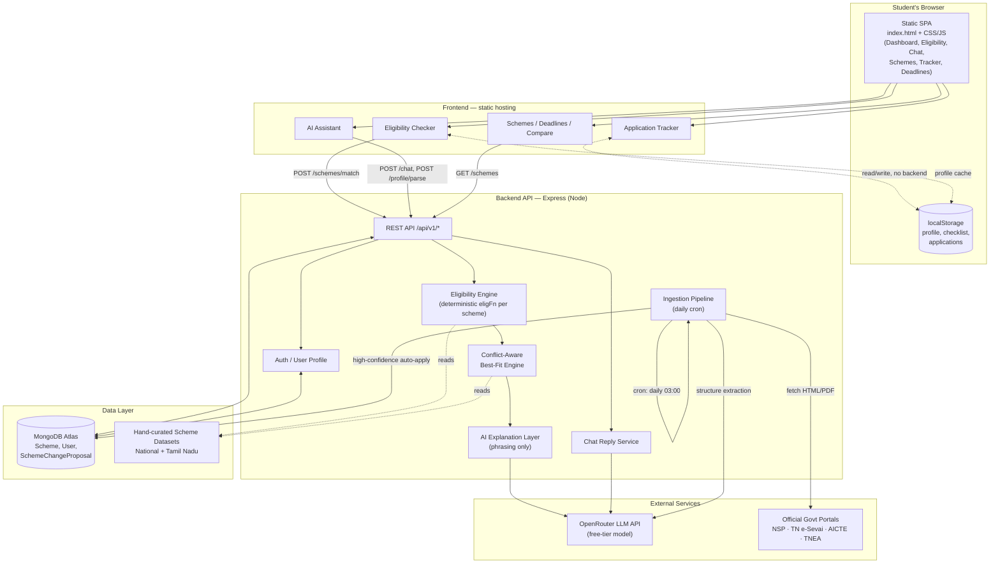

# Scheme Finder — System Design

Diagrams reflect the actual codebase (`backend/src/**`, `frontend/src/js/**`), not an idealized/target architecture.

Raw mermaid source (no markdown, no fences) lives in `docs/diagrams/hld.mmd` and `docs/diagrams/lld.mmd` — copy from those files, not from this one, when pasting into an external tool like Excalidraw. This file embeds the same content only for GitHub/IDE preview.

## High-Level Design

## Low-Level Design

```mermaid
graph TB
    subgraph FEModules["Frontend Modules (frontend/src/js)"]
        init["init.js<br/>boot orchestration"]
        state["state.js<br/>U profile, fetchMatch(),<br/>saveProfileLocal, CHECKLIST"]
        eligEngineFE["eligibility-engine.js<br/>SCHEMES[] + eligFn (national)"]
        tnSchemesFE["tn-schemes.js<br/>TN_SCHEMES[] + tnDomicile()"]
        conflictFE["conflict-engine.js<br/>computeBestFit()<br/>maxWeightIndependentSet()"]
        eligibilityJS["eligibility.js<br/>runElig(), fillEligibilityForm(),<br/>parseNLProfile(), renderBestFit()"]
        chatJS["chat.js<br/>getReply()/reply() router,<br/>GUIDED_APP, handleWhatIfQuery(),<br/>DIRECT_REGISTRATION_DIRECTORY"]
        trackerJS["tracker.js<br/>APPLICATIONS[], exportIcs()"]
        panelsJS["panels.js<br/>renderSchemes(), renderDeadlines()"]
        navJS["navigation.js<br/>goPanel(), goApp()"]
        authJS["auth.js<br/>register/login"]
    end

    init --> state
    init --> panelsJS
    eligibilityJS --> state
    eligibilityJS --> eligEngineFE
    eligibilityJS --> tnSchemesFE
    eligibilityJS --> conflictFE
    chatJS --> state
    chatJS --> eligEngineFE
    chatJS --> tnSchemesFE
    chatJS --> conflictFE
    chatJS --> trackerJS
    navJS --> chatJS
    navJS --> trackerJS
    navJS --> eligibilityJS
    state -->|"POST /schemes/match"| matchCtrl
    state -->|"GET /schemes"| schemesCtrl
    chatJS -->|"POST /chat"| chatCtrl
    eligibilityJS -->|"POST /profile/parse"| profileCtrl
    authJS -->|"POST /auth/*"| authCtrl
    state -->|"GET/PUT /user/profile"| userCtrl

    subgraph Routes["backend/src/routes"]
        schemesR["schemes.routes.js"]
        chatR["chat.routes.js"]
        profileR["profile.routes.js"]
        authR["auth.routes.js"]
        userR["user.routes.js"]
        ingestR["ingestion.routes.js"]
    end

    subgraph Controllers["backend/src/controllers"]
        schemesCtrl["schemes.controller.js<br/>listSchemes, getScheme,<br/>matchSchemes"]
        matchCtrl(("matchSchemes"))
        chatCtrl["chat.controller.js"]
        profileCtrl["profile.controller.js"]
        authCtrl["auth.controller.js"]
        userCtrl["user.controller.js"]
        ingestCtrl["ingestion.controller.js<br/>runNow, listProposals,<br/>reviewProposal"]
    end

    schemesR --> schemesCtrl
    chatR --> chatCtrl
    profileR --> profileCtrl
    authR --> authCtrl
    userR --> userCtrl
    ingestR --> ingestCtrl

    subgraph Services["backend/src/services"]
        eligEngineBE["eligibilityEngine.js<br/>scoreScheme()"]
        conflictBE["conflictEngine.js<br/>computeBestFit()"]
        compatRules["compatibilityRules.js<br/>getCompatibilityStatus()<br/>MANUAL_RULES + exclusiveGroup"]
        aiExplainSvc["aiExplain.service.js<br/>explainMatch() — phrasing only,<br/>4s timeout, template fallback"]
        chatReplySvc["chatReply.service.js<br/>5s timeout, fallbackReply()"]
        profileParserSvc["profileParser.service.js<br/>5s timeout, deterministicExtract()"]
        orClient["openrouter.client.js<br/>chatComplete(), reasoning:false,<br/>DEFAULT_MODEL=free tier"]
    end

    schemesCtrl --> conflictBE --> eligEngineBE
    conflictBE --> compatRules
    schemesCtrl --> aiExplainSvc --> orClient
    chatCtrl --> chatReplySvc --> orClient
    profileCtrl --> profileParserSvc --> orClient

    subgraph IngestionPipe["backend/src/services/ingestion"]
        runIngest["runIngestion.js<br/>ingestOne(), discoverOne()"]
        sources["sources.js<br/>vetted URL registry"]
        fetchHtml["fetchHtml.js"]
        fetchPdf["fetchPdf.js"]
        discover["discoverListing.js<br/>cheerio crawl"]
        structureLLM["structureViaLLM.js<br/>extraction-only prompt"]
        applyProp["applyProposal.js<br/>allowlisted field merge"]
    end

    ingestCtrl --> runIngest
    runIngest --> sources
    runIngest --> fetchHtml
    runIngest --> fetchPdf
    runIngest --> discover
    runIngest --> structureLLM --> orClient
    runIngest -->|"confidence: high"| applyProp
    ingestCtrl -->|"manual review<br/>(medium/low confidence)"| applyProp

    subgraph Models["backend/src/models"]
        schemeModel[("Scheme.model.js<br/>+ durationYears, renewal")]
        proposalModel[("SchemeChangeProposal.model.js")]
        userModel[("User.model.js<br/>bcrypt password")]
    end

    subgraph DataFiles["backend/src/data"]
        natSchemes["nationalSchemes.js"]
        tnSchemesBE["tnSchemes.js"]
    end

    schemesCtrl --> schemeModel
    schemesCtrl --> natSchemes
    schemesCtrl --> tnSchemesBE
    eligEngineBE -.->|"eligFn defined on"| natSchemes
    eligEngineBE -.->|"eligFn defined on"| tnSchemesBE
    applyProp --> schemeModel
    ingestCtrl --> proposalModel
    authCtrl --> userModel
    userCtrl --> userModel

    subgraph Cron["server.js"]
        nodeCron["node-cron: 0 3 * * *"]
    end
    nodeCron --> runIngest
```

### Notes

- `matchSchemes` is drawn as a sub-node of `schemes.controller.js` since it's one function inside that file, not a separate module — mermaid has no clean "function inside file" primitive. Everything else maps 1:1 to a real file.
- `Tracker` (Application Kanban + `.ics` export + ID vault) is entirely `localStorage`-backed today — no backend model exists for it yet.
- Timeouts on `aiExplain.service.js` / `chatReply.service.js` / `profileParser.service.js` (4-5s) and `reasoning: false` on `openrouter.client.js` were both fixed this session after live end-to-end testing surfaced a 15s hang on the free OpenRouter model.
