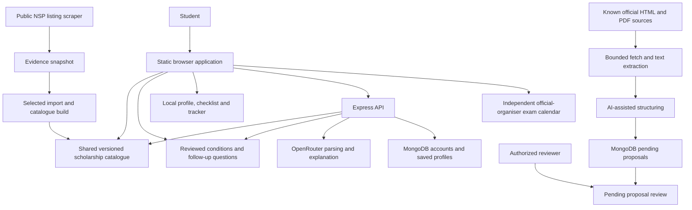

# SchemeMatch: project explanation and hackathon preparation

> **Current prototype update — 10 October 2026:** The implementation changed after this guide's 9 October snapshot. Seven central records now have enabled screening/rate logic; profile-relevance percentages and guided documents are active, and the public app shell has offline caching. Older statements below about all matching being disabled, withheld benefit calculators and absent reload caching are historical. For today's verified scope, functions and rehearsal script, read [PROTOTYPE_ROUND_SCRIPT_2026-10-10.md](/Users/aryakumar/Desktop/schemematch/docs/PROTOTYPE_ROUND_SCRIPT_2026-10-10.md). Today's local rerun passed 150 tests.


Reviewed on 9 October 2026 against the local working tree. This is an explanation of the implementation, not a certification of government eligibility or a production security audit. Existing code, credentials and presentation files were not edited. The tree changed during review; the final inventory and validation snapshot below distinguish source JSON from the published browser/API bundle.

**Presentation reading path:** Start with sections 19–24 for the Excalidraw review, system design from scratch, feature walkthrough, live demo, pitch and technical Q&A. Sections 1–18 provide the deeper implementation evidence, file map and package inventory.

## 1. What you have built

SchemeMatch helps a student discover government education programmes, understand selected published conditions, identify missing personal details and reach an official information or application route. It also lets the student keep a personal application tracker.

Think of a student called Priya. She knows her family income and course, but does not know which department operates a scholarship, whether an advertised deadline is for new applicants or renewal, or whether her institution type matters. SchemeMatch puts relevant listings in one place, asks necessary follow-up questions and explains the limits of its answer.

The most defensible description is:

> SchemeMatch is an independent scholarship discovery assistant that combines official-source programme information, conversational profile entry and explainable checks of selected published conditions.

There is also a conflict-graph optimisation engine in the repository. It can choose a maximum-value subset from schemes with executable eligibility rules and known conflicts. It is a meaningful technical prototype. However, all records in the published directory currently have `matchingEnabled: false`. The active application deliberately does not present its unreviewed legacy rules as confirmed scholarship awards.

### Four distinctions you should understand

| Statement | What it actually means |
|---|---|
| A programme is relevant | Its location and available audience metadata fit the student's context; complete eligibility is not established. |
| A student meets reviewed conditions | The selected conditions implemented from a source pass for their self-declared facts. Other conditions and the current cycle may remain unreviewed. |
| A programme's source is official | The saved URL satisfies the project's domain policy and the directory records a source review. This is not government endorsement of SchemeMatch. |
| An application is marked verified in the tracker | The student moved the card to that stage. SchemeMatch did not contact the college or government to verify it. |

This separation is one of the project's strongest design choices. It prevents a missing fact from quietly becoming a confident answer.

## 2. The actual technology stack

The working frontend uses HTML, ordinary CSS and vanilla JavaScript. It loads separate script files in a fixed order, shares browser globals and changes visible panels without a page navigation. There is no active React, Next.js, Vite or Tailwind build in the start command.

The backend uses Node.js and Express. Routes receive requests, controllers validate and coordinate them, services perform parsing/checking/extraction, and Mongoose models describe persisted records.

MongoDB is used for accounts and the source-review queue. The versioned catalogue and necessary-condition checks do not depend on a successful database connection. A seed script can mirror catalogue metadata into MongoDB, but the live catalogue controller reads the committed shared bundle rather than arbitrary database records.

OpenRouter provides optional language-model calls. Browser speech recognition captures spoken input. Google translation is used for translating page content and converting a description to English before parsing; these are separate integrations.

React and Next.js-looking files exist under `components/`, but the active HTML does not load them. Their imports include dependencies that are absent from the declared active packages. Present them as unused design scaffolding, not the deployed stack.

### Direct packages and their human explanation

Versions here come from the lockfiles inspected during this review; they describe this checkout, not the newest versions available online.

| Package | Locked version | Purpose in this project | Easy way to explain it |
|---|---:|---|---|
| express | 4.22.2 | Backend routing and HTTP middleware | The receptionist that sends each request to the correct handler. |
| mongoose | 7.8.12 | MongoDB models, validation and queries | Gives database records an agreed structure and useful methods. |
| bcryptjs | 2.4.3 | Password hashing with cost 12 | Stores a password hash so the original password need not be stored. It is hashing, not reversible encryption. |
| jsonwebtoken | 9.0.3 | Signed login tokens | Lets the API verify the account identity carried by a request. JWT contents are not automatically encrypted. |
| cors | 2.8.6 | Browser cross-origin policy | Allows the frontend origin to call the API. It does not authenticate a user. |
| helmet | 7.2.0 | Security-related response headers | Sets browser protections at the API boundary. |
| express-rate-limit | 8.7.0 | AI and account request limits | Stops a single IP from repeatedly hammering expensive or sensitive endpoints. |
| dotenv | 16.6.1 | Reads environment configuration | Keeps deployment configuration and secret values outside application source. |
| morgan | 1.12.0 | HTTP request logging | Records requests for operational debugging. |
| node-cron | 4.6.0 | Optional scheduled ingestion | An alarm clock for the persistent backend process. |
| cheerio | 1.2.0 | Parses downloaded HTML | Lets code select headings, links and text without opening a full browser. |
| pdf-parse | 2.4.5 | Extracts text from PDFs | Reads a PDF's existing text layer; it does not perform OCR in this project. |
| nodemon | 3.1.14 | Development server restart | Restarts Node when a developer edits backend files. |
| jsdom | 25.0.1 | Browser-like DOM for tests | Runs real browser code in an isolated simulated page. It is not a real microphone or rendering engine. |
| puppeteer | 25.11.0 | Browser automation tooling | Can automate Chromium for browser checks and exports. It is not the active scheduled HTML scraper. |
| pptxgenjs | 4.0.1 | PowerPoint generation tooling | Produces presentation files; it is not an application feature. |

Node supplies `fetch`, `AbortController`, crypto hashing, file access and the built-in test runner. There is no Axios dependency, separate OpenRouter SDK, Python scraping service, vector database or trained scholarship model in the active implementation.

The root manifest declares Node >=18, but locked tooling requires newer runtimes: Puppeteer requires >=22.12, Cheerio >=20.18.1 and pdf-parse has its own supported Node ranges. The manifest's minimum is therefore not sufficient for every installed tool. Choose a compatible runtime from the locked engine requirements before the demo.

Both lockfiles include indirect packages: for example, HTML parser helpers, the MongoDB driver, PDF tooling and Chromium automation helpers. The dependency inventory appended below lists them separately. Their presence does not imply an independently built product feature, and this review does not claim to audit every line of vendor source.

## 3. System design in ordinary language

There are two main flows: helping a student and maintaining programme evidence.

### Student flow

```text
Student types or speaks a description
  -> optional speech transcription and translation
  -> profile extraction, enum checks and deterministic corrections
  -> student reviews the filled form
  -> relevant catalogue listings and necessary-condition checks
  -> progressive follow-up questions where needed
  -> explanation with official source links
  -> student opens the official portal and maintains a local tracker
```

The frontend normally calls `POST /api/v1/schemes/match`. If the API cannot be reached or does not return the expected catalogue version, the browser uses its bundled catalogue and shared condition evaluator. The browser's request timeout is eight seconds. Responses arriving after profile changes are discarded.

The server returns separate fields for `relevantListings`, `reviewedConditions`, `eligible`, `bestCombo`, compatibility information and explanation. With the current disabled catalogue, confirmed award arrays remain empty and the combined award total is zero. A relevant listing can still appear and a necessary-condition check can still be useful.

### Evidence maintenance flow

```text
Official public page or PDF
  -> URL and redirect validation
  -> bounded download
  -> HTML/PDF text extraction and source hash
  -> optional LLM proposal extraction
  -> persisted pending proposal
  -> authorised reviewer records approval/rejection
  -> accepted facts are separately edited into versioned JSON
  -> catalogue build produces the shared bundle
  -> deployment/reload makes the published version available
```

Review approval is not publication. The current controller explicitly responds with `published: false`. A human still has to update the source JSON and rebuild. The build currently rejects records that attempt to enable matching or assign nonzero award totals, so activating full award decisions requires a deliberate change to the publication controls as well as complete rules.

### Why this architecture fits the prototype

Static hosting can deliver the interface and catalogue cheaply. Local checks avoid a database query for every criterion. The backend provides optional AI and account persistence. The external government portal remains responsible for applicant authentication, document checks, selection and payment.

The trade-off is maintenance complexity: browser globals depend on script load order, large files contain older logic, and some legacy eligibility functions have separate frontend/backend copies. The shared current evaluator reduces that drift, but does not remove all historical duplication.

## 4. Web scraping: exactly what happens

Web scraping means downloading a page and turning its structure into usable data. Imagine reading a government notice and copying its scheme name and date into a table. The scraper automates part of that copying; it cannot independently decide that the policy applies to a student.

### A. Public NSP catalogue scraper

`scripts/scrape-nsp.cjs` reads the public National Scholarship Portal catalogue. It uses Node fetch and Cheerio, follows public classification and domicile filters, and parses catalogue cards. It extracts programme names, department, academic year, opening/closing dates, application route, guideline/FAQ links and officer verification windows.

The classification and state filters use form-encoded POST requests because the portal exposes those listings through form endpoints. The scraper deduplicates candidate records using an ID derived from a programme name hash and records page hashes and failed requests. Its output is an evidence snapshot under `docs/evidence/`; it does not itself update the browser catalogue.

The inspected stored snapshot reports 28 fetched pages and 176 candidate records with no recorded fetch failures. This describes that stored scrape, not 176 fully reviewed scholarships available in the app. Case-sensitive programme-name hashes can leave semantically duplicate names; the snapshot includes casing variants. An import/review stage is necessary.

`scripts/import-nsp.cjs`, which appeared during this review, imports selected snapshot records into the state/central JSON files. It restricts state records to the approved states, merges recognised central programmes through aliases and skips certain state umbrella overlaps. It keeps new records information-only. It should be run only after inspecting the snapshot. Its alias/deduplication policy is a maintenance heuristic, not proof that every duplicated programme has been resolved.

It does not log in to applicant accounts, scrape a student's private dashboard, solve CAPTCHAs or submit an application.

### B. Optional scheduled ingestion

`sources.js` derives known official sources from the published catalogue. `runIngestion.js` processes those known records, rather than searching the entire internet for new programmes.

For an HTML page, `fetchHtml.js` downloads at most 2 MB, removes scripts/styles/navigation and flattens body text. Extraction input is limited to 20,000 characters. It records whether text was truncated and hashes the fetched HTML.

For a PDF, `fetchPdf.js` downloads a bounded body, uses `PDFParse.getText()` and extracts at most 20,000 characters. Fewer than 200 characters is flagged as low text yield. This can indicate a scanned PDF; the project has no automatic OCR stage. Low-text and truncated sources remain unsuitable for automated structuring.

`officialFetch.js` checks HTTPS and permitted hosts before fetching. Every redirect is checked again, with a maximum redirect count. The policy allows `.gov.in`, `.nic.in` and a named Haryana academic-domain exception, rejects embedded credentials and rejects nonstandard ports. This reduces unsafe and misleading destinations, but it is not a complete production network-security assessment or a guarantee of each page's policy quality.

`structureViaLLM.js` asks the language model for explicit source facts, with null for missing facts and strict JSON output. It tells the model to treat source text as untrusted data and to extract only the named programme. Type validation follows parsing. These measures reduce invention; the reviewer is still necessary because a model can make a factual extraction error while returning valid JSON.

Every result remains pending, including an extraction marked high confidence. Fetch errors are retained in the review record. A SHA-256 hash is an evidence fingerprint: it helps identify what content was fetched. It is not a signature from the government and does not prove that extracted facts are correct.

### Scheduling and runtime limits

The persistent server schedules ingestion at 03:00 Asia/Kolkata only when `INGESTION_ENABLED=true`. It skips ingestion if the database cannot persist the review queue. It uses an in-process flag to prevent two overlapping runs in the same process. That is not a distributed lock across multiple servers.

The Vercel function entry does not run background cron. A deployed scheduled trigger would require additional configuration. Merely having `node-cron` installed does not mean the deployed function refreshes data daily.

`discoverListing.js` contains older TN directory discovery, keyword filtering and generated IDs. `applyProposal.js` contains older database merge helpers. The active ingestion runner/controller do not call those publication/discovery paths. Some comments and diagrams still describe an older auto-apply implementation and must not be used as evidence of current behaviour.

### Scraping limitations to explain honestly

HTML structure can change. Login-only or JavaScript-heavy pages may not yield useful text. A fetched listing may describe renewal rather than fresh applications. Different scholarship cards on the same page can have different dates. A newly uploaded PDF can contain an older policy. A successful HTTP response does not prove the student's application route works.

The current system addresses part of this with source metadata, pending proposals and publication controls. Further work includes extraction-diff tools, review workflow improvements, caching unchanged source hashes, deduplication and a validated OCR workflow for scanned sources.

## 5. Profile parsing, voice and translation

The parser turns a description into fields such as category, course, annual-income bracket, state and special status. For example:

```text
My name is Priya Sharma. I study BCA in Tamil Nadu.
My annual family income is 1.8 lakh. I am BC.
```

The profile can contain `name: Priya Sharma`, `edu: ug-arts`, `stream: science`, `state: Tamil Nadu`, `cat: BC`, and `inc: 1to2.5`. BCA maps to the app's general UG group; that internal key does not imply that BCA is a humanities degree.

The backend first tries OpenRouter if a key is configured. It validates returned enums and applies deterministic checks for income and explicit positive/negative status. On unavailable AI it uses pattern matching. Missing category, education or income is reported rather than silently invented.

Useful examples covered by fixtures:

| Input | Intended behaviour |
|---|---|
| My father is not disabled. I am disabled. | Keeps parent and student disability distinct. |
| My old income was 2 lakh; now it is 9 lakh. | Uses the correction. |
| My family income is 20,000 per month. | Converts explicit monthly income to 2.4 lakh annually. |
| My tuition fee is 2 lakh. | Does not treat the tuition fee as household income. |
| If I am disabled, can I apply? | Does not record disability as a stated fact. |
| My income is below 2 lakh. | Leaves an uncertain bucket unresolved under the conservative current parser. |

These examples demonstrate tested behaviour, not complete language understanding. Other profile fields still rely on regex/LLM interpretation. City-to-state mapping is a convenience, not proof of domicile; free-text field validation and extraction accuracy need broader evaluation.

### Voice flow

The browser uses `SpeechRecognition` or `webkitSpeechRecognition`, with a fixed locale for each session. It accumulates final/interim transcript text, stops once, optionally translates, then fills the profile. It retains text when translation fails and allows manual entry. It bounds restart attempts and handles microphone permission, unsupported-language and network errors.

The app provides 11 options: English, Tamil, Hindi, Telugu, Marathi, Kannada, Malayalam, Bengali, Gujarati, Punjabi and Urdu. Configuration of a locale is not evidence that the student's browser supports it accurately. Tests simulate recognizer events; actual microphone recordings and population-level language accuracy were not established here.

Do not describe this as a custom speech model or an OpenAI Whisper implementation. The application uses the browser's speech interface. Browser/OS services may process audio online, so voice is not guaranteed offline.

### Translation has two jobs

`lang.js` controls a Google Translate page widget for interface translation. `eligibility.js` separately requests translation of a typed/spoken profile to English, first directly and then through the backend translation endpoint as a fallback. The backend uses a Google translation web endpoint, not a separately configured paid translation SDK.

Speech, translation and model extraction can each introduce errors. That is why the current flow asks the student to review fields before checking conditions. Selection of a language is an accessibility option, not a demonstrated accuracy percentage.

## 6. Necessary-condition checks and follow-up questions

`reviewed-conditions.js` is shared directly by browser and backend. Its data-driven checks support one-of values, minimum numbers, income ceilings and course-route decisions. Relevance gates use state context, category and education before asking additional questions.

The results are:

| Status | Meaning for a student |
|---|---|
| more-information-needed | A fact required by a reviewed check is unknown. |
| fails-reviewed-condition | A declared fact fails one of the reviewed necessary conditions. |
| meets-reviewed-conditions | Those limited checks pass; full rule review remains pending. |
| needs-source-review | This branch or an inconsistency needs further source review. |

The evaluator explicitly returns `eligible: false` for these partial reviews. It does not convert passing a few conditions into an award.

### Haryana example

A Haryana SC student in an undergraduate course with low income may be asked for domicile, then institution type, then attendance. Saved answers are reused. Attendance of 75 passes the implemented minimum; 74.99 fails. A known failure suppresses questions that cannot change that failure.

The app does not automatically convert all-India OBC into Haryana BC. The currently implemented Haryana listing is a directory family; separate SC/BC programme rules still need complete review.

### Tamil Nadu example

The checked BC/MBC/DNC table branches distinguish a three-year general UG degree, a three-year polytechnic and a four-year professional course. The current general-degree branch checks government/aided institution type without borrowing the professional branch's first-graduate/income conditions. The professional branch conditionally asks about government quota for a self-financed institution.

This is a good judge demonstration: the software follows the selected rule branch instead of asking every student every question. It does not independently validate a certificate or cover every TN scheme.

### CSSS example

Fresh CSSS checks distinguish board percentile from percentage marks. A student's 80% marks cannot automatically become proof that they are above the board's 80th percentile. Renewal follows different annual examination and attendance questions. The saved published window for CSSS is labelled renewal; it cannot establish that fresh registration is open.

### Exact-income boundaries

Suppose the source condition is annual income <=250,000 rupees. A bracket entirely below that ceiling can pass the income check without another question. A bracket spanning the ceiling needs an exact amount. 250,000 passes an inclusive ceiling; 250,001 fails.

This is stronger than comparing bracket names alone. The code also clears affected follow-up answers when income, state, course or stream changes, hides stale results and rejects late matching responses after edits.

## 7. The conflict optimiser: the algorithm and its current limits

Imagine three fictional awards:

| Scheme | Fictional annual value | Conflict |
|---|---:|---|
| A | 10,000 rupees | Cannot be combined with B |
| B | 16,000 rupees | Cannot be combined with A |
| C | 3,000 rupees | No recorded conflict with A or B |

For this synthetic model, B+C has value 19,000 and is better than A+C at 13,000. These are invented teaching values, not programme claims. The absence of a recorded conflict is not real-world proof of permission.

A graph represents each eligible scheme as a node. A conflict edge means two nodes cannot both be selected. The weight is `amtNum`. The solver seeks the maximum-weight independent set: the highest total weight among subsets with no conflict edge inside them.

For up to 20 input schemes, the code enumerates every bitmask subset. At n=20 that is 1,048,576 subsets. Each subset checks selected nodes against conflict masks and adds weights. Approximate time complexity is O(n*2^n), with O(n^2) graph construction. Exact optimisation applies only to the supplied graph and values.

For more than 20 schemes, the code uses a greedy per-group fallback. That method is not guaranteed to find the optimum. A synthetic check during this review also showed that the current large-list fallback can retain both members of a one-directional `conflictsWith` pair: a higher-valued A declares conflict with B, but B does not declare the reverse. This requires hardening before claiming even conflict-valid large-list output. The small-list bitmask path checks pair conflicts symmetrically.

The separate compatibility layer can return ALLOWED, NOT_ALLOWED or UNKNOWN; its design also describes CONDITIONAL. The inspected manual table has two legacy ALLOWED pairs. Unknown pairs are labelled but can still enter the proposed optimiser output; the compatibility table is not a complete constraint system. Homepage-style claims that every suggested bundle is legally safe are not justified.

The published catalogue disables awards, so these legacy optimizer risks are currently kept out of confirmed active results. You can show the algorithm on clearly synthetic inputs as a prototype and explain that reviewed full eligibility, benefit calculations and pair-specific compatibility are prerequisites for a real recommendation.

The repository contains no measured benchmark establishing less than 50ms end-to-end operation. Voice, translation and network AI calls can take much longer than local rule evaluation. Report measured stages separately if you benchmark later.

## 8. Chat: local answers and optional model calls

The active `getReply()` calls `catalogueReply()` first. Recognised scholarship, scheme, certificate, application and many related questions receive local information from the shared catalogue. The separate exam calendar now renders official-organiser references, published-date countdowns, past schedules and explicit unconfirmed dates; older chat responses may still give notice links rather than the calendar view.

For other requests, routing may use existing handlers or POST to the backend chat endpoint. The backend supplies catalogue facts and computed eligible facts to OpenRouter, with instructions not to invent scheme details. It uses a five-second model timeout; the browser gives the chat request six seconds. If the model is unavailable, local reply logic is used.

There is no embedding-based retrieval, vector search or retrieval-augmented generation infrastructure here. Sending the compact catalogue as model context is grounding, but should not be marketed as a vector RAG system. There is no model fine-tuning or custom training dataset shown.

`chat.js` is large and still contains older document procedures, examination guides, what-if simulations and guided application steps. Many normal requests are intercepted by the new catalogue guard. Their presence is not evidence that the published product provides a verified document assistant or valid what-if award simulator.

One exposed legacy function, `startGuidedApplication()`, currently references `addMsg` in its catalogue branch, while this file's active renderer is `addAI`. Unless another loaded script provides that binding, direct invocation can fail. This is a code-review finding; it was not part of the main current catalogue demo.

The LLM output renderer escapes HTML and adds only limited bold/newline markup. Plain Markdown hyperlinks returned by the model are not converted into clickable anchors there; programme catalogue answers construct approved source anchors themselves.

The AI explanation service is a phrasing layer for already-computed results. With no best combination in the pending catalogue, it returns a template without a model call. Its schema checks do not prove that every model sentence exactly preserves the input facts, so avoid a zero-hallucination guarantee.

## 9. Accounts, storage and tracking

Guest profiles are stored in browser localStorage. There are also local keys for form values, the form lock, language preference, checklist and tracked applications. Session storage remembers the visible page/panel.

Accounts use bcrypt password hashes and signed JWTs. Registration assigns the default student role; a client cannot register as a reviewer. The protected review flow requires a trusted database role plus membership in an environment email allowlist.

The backend persists profile and saved scheme IDs. Special eligibility facts are retained in the account model, with an allowlist sanitizer for additional details. They are self-declared, not verified government documents.

The application tracker is local-only. It has five stages: Discovered, Documents Ready, Applied on Portal, College Verified and Disbursed. Students move cards manually and can record a deadline and application reference. There is no tracker MongoDB model, external application-status API or DBT verification integration.

The .ics export writes tracked dates into calendar events. It creates a downloadable file; it does not schedule server emails, SMS or push notifications. The current all-day export sets DTSTART and DTEND to the same date, which can lead to inconsistent calendar duration handling; calendar interoperability should be checked before promising reminders.

LocalStorage is persistence in a browser, not encryption. Clearing browser storage can remove a guest profile and tracker. Logging out clears the token but leaves local profile/tracker data. A future production design should address shared-device privacy, token storage, consent and deletion behaviour. The current tests do not constitute a complete privacy/security audit.

The repository's latest existing status document records a MongoDB authentication problem. This review did not read credential files, reconnect to Atlas or independently verify whether that configuration has since been fixed. Present persistence as implemented but needing an integration check before a live account demo.

## 10. APIs and deployment

All application endpoints below use `/api/v1`.

| Method and route | Purpose | Access |
|---|---|---|
| GET /schemes | Shared catalogue, optional type/state/sector filters | Public |
| GET /schemes/:id | Stable-ID programme information | Public |
| POST /schemes/match | Relevance, reviewed conditions and controlled matching payload | Public; AI rate limit |
| POST /profile/parse | Description to profile | Public; AI rate limit |
| POST /profile/translate | Text translation fallback | Public; AI rate limit |
| POST /chat | Optional grounded model reply | Public; AI rate limit |
| POST /auth/register | Create student account | Database/config required; auth rate limit |
| POST /auth/login | Sign in | Database/config required; auth rate limit |
| GET /auth/me | Account identity | JWT protected |
| GET /user/profile | Saved account/profile | JWT protected |
| PUT /user/profile | Profile update | JWT protected |
| GET /user/saved | Saved programme IDs | JWT protected |
| POST /user/saved/:id | Save programme ID | JWT protected |
| DELETE /user/saved/:id | Remove saved programme ID | JWT protected |
| POST /ingestion/run | Trigger evidence fetch | JWT, reviewer role and email allowlist |
| GET /ingestion/proposals | Read pending/reviewed proposals | Same reviewer restrictions |
| PATCH /ingestion/proposals/:id | Record approval/rejection and review note | Same reviewer restrictions |

`GET /health` is outside the API prefix. It reports a process response; its static stage marker is not a database-readiness check. There are 17 listed application method/route combinations plus health, so the old deck's blanket count of 12 endpoints is stale.

The root start command serves `frontend/src` on port 3000. Local browser API calls use port 5050. Production defaults to `/api/v1`, with an optional HTTPS API override in `config.js`.

The root Vercel config checks the generated catalogue, serves the static directory and rewrites API requests into the Express function wrapper. It bundles the shared modules needed by the backend. Separate frontend/backend Vercel files describe alternative layouts; deploying the root is the configuration intended to keep the shared files together.

The serverless wrapper connects to Mongo only for account/user/ingestion routes and caches the connection attempt for warm invocations. A persistent Node server tries Mongo at start, but still serves catalogue functionality if the connection fails.

Rate limits are per IP: 20 requests per minute for protected AI paths and 30 account requests per 15 minutes. The default rate-limit store is process-local; production multi-instance deployment needs an operational decision about shared limiting and proxy configuration.

The app is resilient when the API is down after assets load. No service worker or explicit installable PWA/offline asset cache was found. Do not promise a first visit with no internet, offline voice translation or offline government submission.

## 11. Existing pitch material needs factual revision

The six-slide PPTX/HTML/PDF and the 29-page documentation PDF describe an earlier TN-centric version. They should be treated as drafts. The more recent data-flow document is closer to active behaviour, but directory counts are changing in the working tree.

| Existing claim | Why it is unsafe to use | More accurate pitch wording |
|---|---|---|
| 1,200 crore rupees go unclaimed/rejected every year | No supporting primary evidence accompanies the number in the inspected materials. | Students struggle to find and interpret fragmented scholarship information. |
| Guaranteed 62,000 rupees per student | Synthetic/legacy estimates are not a verified award. Active totals are withheld. | We help students find relevant programmes and understand the next verified checks. |
| Zero rejections | Government decisions are outside this product; no beneficiary evaluation supports it. | We aim to reduce avoidable mistakes, then measure that in a pilot. |
| 100% legally valid combinations | Rules and pair permissions are incomplete; UNKNOWN is possible. | A tested conflict-graph prototype awaits complete source-backed constraints. |
| Less than 50ms end-to-end | No benchmark proves it; model and translation calls are network operations. | Local checks are deterministic; we measure network stages separately. |
| 100% offline | Assets need loading; AI, translation, account sync and portals need connectivity. | The bundled directory and local checks survive backend outages. |
| Fully audited 30+ schemes | Legacy test fixtures do not validate every current policy. | Official-source listings with explicit verification scope and selected condition checks. |
| High-confidence extraction automatically publishes | Current runner returns autoApplied:0 and keeps proposals pending. | Scraping creates evidence proposals for authorised review. |
| Adding a valid scheme takes two minutes, no deployment | Full guideline review takes work; JSON build/publication is required. | The common schema reduces integration work after evidence review. |
| No external frontend dependencies | Fonts, page translation, text translation and browser speech services are external. | The core interface uses vanilla JavaScript without a frontend framework. |
| Ministry of Education endorsement | Branding and official source links do not establish affiliation. | An independent hackathon prototype using official references. |
| Automatic application and DBT tracking | Links and manually moved tracker stages are the implementation. | Students apply externally and record their own progress. |

A source-backed, candid pitch will withstand questions better than the older guarantees.

## 12. A three-minute spoken pitch

> Imagine a student who has earned a college seat but is worried about fees. She has heard that scholarships exist, yet each programme has a different department, application route and set of conditions. Even a date can be misleading if it belongs to renewal rather than a new application.
>
> We built SchemeMatch to help her work through that confusion. She can describe herself in ordinary language, or use the browser's voice input. Our parser fills the profile, and she reviews it before any checks run.
>
> The platform shows relevant central and state programmes with official source links. For conditions we have reviewed, it explains what passed, what failed and which detail is still missing. It asks follow-up questions only when they matter. For example, a scholarship may need institution type and attendance, while another needs a fresh-versus-renewal distinction. We keep unknown details unknown.
>
> Underneath, we share a versioned catalogue and a condition evaluator between the browser and our Express API. That keeps local and server behaviour aligned. If the backend is unavailable, students can still browse the loaded catalogue and use the local checks.
>
> Our source-maintenance pipeline reads official HTML and text-based PDFs, records evidence hashes and proposes structured updates. A model can help extract text, but it cannot approve policy. An authorised reviewer must review the evidence, and publication is a separate versioned step.
>
> We have also built a graph-based optimiser for future scholarship combinations. It models known conflicts and finds a maximum-value subset for small inputs. We demonstrate that algorithm on controlled fixtures while withholding unreviewed real-world award combinations.
>
> A student can then open the official route and keep a personal application tracker. Our next milestone is to finish full current-cycle rule review for a focused set of programmes, evaluate answers against a labelled dataset and test the journey with students and college scholarship staff.

Insert the final published catalogue count from the snapshot below only after build validation. Do not insert proposed JSON additions as already deployed coverage.

## 13. Demo sequence

1. Open the schemes browser and show your chosen state's programmes alongside central listings. Open a source link and point out the recorded verification scope.
2. Enter an English description, parse it and review the fields. Use English for a dependable primary demo; prepare a real tested microphone sample separately if showcasing another language.
3. Show Haryana's progressive questions or the TN course-branch distinction. Demonstrate a passing boundary and a failure, then point out that the result still says full review pending.
4. Show CSSS fresh/renewal distinction and explain why percentage and percentile are different.
5. Add a listing to the tracker, move it manually and export a calendar file. Say explicitly that the stages are student-reported.
6. If showing the optimiser, use labelled fictional schemes and known conflicts. Explain the exact-small-list/heuristic-large-list split and current hardening requirement.
7. Finish with source review/publication design. A screenshot or prepared pending proposal is appropriate if database integration is unavailable; do not claim a screenshot proves a live fetch or database write.

## 14. Judge questions and answers

**Q: What problem are you solving?**

A: We help students discover relevant government education programmes and interpret selected conditions without navigating unrelated departmental pages first. We make the source and uncertainty visible.

**Q: Why not just use Google or a generic chatbot?**

A: SchemeMatch connects the student's saved profile to a versioned directory, asks targeted follow-ups and returns the exact official source route. A general search result does not maintain that structured journey. We still need a comparative user study before claiming superiority over specific services.

**Q: Where does the data come from?**

A: The published records come from reviewed JSON with official references. A public NSP scraper stores evidence snapshots, and an optional known-source ingestion pipeline proposes updates. Scraped records are not automatically confirmed eligibility rules.

**Q: Is the data live?**

A: It is versioned data with recorded check dates. The app does not query every portal whenever a student opens it. Scheduled checks are optional and updates need review/publication.

**Q: Which AI model did you train?**

A: We did not train a model. The backend calls a configurable OpenRouter model for extraction or phrasing, and has deterministic fallbacks. The source default and environment example name different models; the actual deployment model depends on its configuration.

**Q: Does AI decide whether I get a scholarship?**

A: No. Necessary-condition outcomes come from explicit rules. The government decides selection and payment. Full-rule matching is currently disabled for the published directory.

**Q: How do you prevent hallucinations?**

A: We supply known catalogue facts, use extraction-only instructions, validate outputs, keep missing facts unresolved and review source updates before publishing them. These controls reduce risk; they do not establish zero hallucinations.

**Q: Do you use RAG?**

A: The model receives catalogue facts as context. We do not currently use embeddings or a vector database, so we describe it as grounded prompting rather than an embedding-based RAG implementation.

**Q: Why are results not simply eligible or ineligible?**

A: We sometimes know only a subset of the necessary conditions. Saying more information needed or meets reviewed conditions preserves that distinction and avoids a false guarantee.

**Q: Why ask follow-up questions?**

A: The main form cannot resolve every scheme's special conditions. We ask a missing fact only when a relevant reviewed rule needs it, reuse answers and stop unnecessary questions after a known failure.

**Q: How is the optimiser different from filtering?**

A: Filtering checks each scheme separately. Optimisation considers conflicts between schemes and chooses a subset with maximum total value for the supplied constraints. Complete eligibility and compatibility evidence are still prerequisites for a real recommendation.

**Q: Is MWIS always optimal here?**

A: The bitmask path is exact for up to 20 input schemes. The larger-list path is a heuristic and currently needs conflict-validation hardening. Neither algorithm makes incomplete policy data correct.

**Q: Are different benefit types automatically combinable?**

A: No. Different types do not establish permission. Compatibility must follow the named programmes' current rules; unreviewed pairs remain unknown.

**Q: What happens with scanned government PDFs?**

A: Text extraction may yield almost nothing. We flag low text yield for manual reading; OCR is not wired into the automatic pipeline.

**Q: What if a portal changes its HTML?**

A: Selectors can fail or return incomplete data. We retain fetch/extraction outcomes and do not publish them automatically. Parser fixtures and change monitoring are areas to expand.

**Q: Are you scraping private student data?**

A: The inspected NSP script reads public catalogue pages and advertised filters. It does not enter applicant accounts or submit forms.

**Q: Does it work offline?**

A: The loaded catalogue, local condition checks and local tracker do not require the backend. First-load assets, speech/translation, account sync and government portals still need connectivity.

**Q: How many languages do you support?**

A: There are 11 configured input options and a page translation selector. Real browser recognition and translation accuracy need testing for each supported environment; we do not claim verified all-language accuracy.

**Q: Can it submit applications for students?**

A: It opens official external routes. Applicants complete and submit on those portals. No submission automation or government status integration is implemented.

**Q: Is the application tracker automatically verified?**

A: No. It is a local progress board controlled by the student. Its labels describe stages the student reports.

**Q: Why MongoDB?**

A: Accounts and evolving profile/proposal records fit document structures, and Mongoose provides schemas. The public catalogue remains a shared versioned artifact so discovery can work even when Mongo is unavailable.

**Q: Why keep JSON as well as a database?**

A: The committed JSON/bundle is the publication authority. Mongo stores accounts and proposed evidence, and can mirror catalogue records. An outdated database seed cannot silently replace the reviewed published version.

**Q: Can reviewers approve their own role?**

A: Registration assigns student role. Review endpoints require a database-granted reviewer role and an environment email allowlist, so a supplied role or reviewer name cannot grant access.

**Q: What happens when the AI fails?**

A: Profile parsing uses a pattern fallback, explanation uses a template and catalogue questions use local records. Translation failure remains explicit and the student can fill fields manually.

**Q: How do you measure accuracy?**

A: Current automated tests establish defined fixture behaviour. We still need a labelled dataset reviewed by domain experts, with separate metrics for profile extraction, condition screening, missing-fact handling and source extraction. Test pass rate is not beneficiary accuracy.

**Q: What impact have you proved?**

A: We have implementation and regression evidence, not a measured reduction in rejected applications or an amount of aid delivered. A pilot should measure time to find a relevant programme, correct interpretation, application completion and verified outcomes.

**Q: How would this scale?**

A: The interface/catalogue can be statically served, and current checks are simple record evaluation. Scaling evidence quality requires reviewers, versioned policy changes and programme-specific rules. AI context size, review queues, rate limiting and optimiser growth need further design at larger scale.

**Q: What is your business model?**

A: None is implemented in this repository. Possible future users include college scholarship desks and nonprofit support organisations, but customer demand and funding models need validation. Keep this separate from demonstrated features.

**Q: What is your next milestone?**

A: Complete full current-cycle rules, benefits and combination review for a small set of programmes, validate account persistence and real audio flows, then run a student/college pilot and measure errors and usefulness.

## 15. Findings to address before a pitch

During review, another set of changes expanded the source JSON and rebuilt the generated bundle. The final check finds them aligned. Presentation claims still need to reflect information-only listings and pending full rule review. This review did not rebuild or modify application code.

Other concrete findings are the large-list optimiser conflict defect, legacy `addMsg` reference, node-engine mismatch, stale policy/performance claims and missing full-rule implementation. Existing test coverage is useful but does not test every live AI, microphone, database, official login or deployment path.

The GitHub Actions backend job installs only backend dependencies, while some backend tests import the root `frontend/testHelpers.js`, which needs root jsdom. A clean checkout may therefore need root installation in that job. This is a configuration inference from imports/workflow; this review did not run GitHub Actions.

The app's health handler returns OK regardless of Mongo availability. Some onboarding/landing labels and legacy functions still use more confident matching/apply wording than the current directory supports. Review the actual demo path and update the pitch copy consistently before claiming complete eligibility or document assistance.

No deployment, external application submission, production penetration test or current scholarship-policy certification was performed. The file inventory and package inventory below let you connect every part of the explanation to this checkout.


## 16. Final validation snapshot

The final local `rtk npm test` run passed **114/114 tests**, with no failures or skips. Earlier localhost HTTP tests were blocked by the filesystem/process sandbox; the approved rerun completed them. A temporary catalogue mismatch arose while files were changing and was resolved by the subsequent changes in the working tree, not by edits made for this report.

The final catalogue contains **120 information-only records: 77 state, 31 central and 12 other**. The test suite checks generated JSON/bundle equality, all 15 approved state filters, URL restrictions, pending-rule gates, parser fixtures, follow-up UI, translation/voice error handling, mocked ingestion approval and HTTP catalogue routes without a database. It does not establish real microphone accuracy, live government-policy accuracy, a successful live MongoDB connection, live OpenRouter quality or production performance.

The new exam calendar uses its own JSON and generated bundle, independently of scholarship deadlines. It distinguishes admission and recruitment, central and state, upcoming/past/unconfirmed, validates exact trusted academic organiser hosts and uses Asia/Kolkata for countdown dates. Its `datesVerified` field describes stored source evidence; I did not re-fetch those notices to verify the dates independently. Unknown schedules produce no invented countdown. The language selector has a single movable control, saves language preference, bounds provider retries and ignores stale selections; tests simulate provider behaviour rather than real translation quality.

## 17. File-by-file map

This map covers first-party source, fixtures, configuration, lockfiles and supplied presentation artifacts visible at the final inventory. Secrets, Git internals, installed dependencies and deployment caches are excluded. Generated bundles are checked against their JSON; lockfile dependencies are inventoried, not audited line by line. Large legacy UI/style files were inspected for structure and runtime references as well as relevant logic; this is not a claim that every CSS declaration or binary byte was manually read.

| File | Role and review interpretation |
|---|---|
| [.editorconfig](/Users/aryakumar/Desktop/schemematch/.editorconfig) | Editor whitespace/format defaults. |
| [.github/ISSUE_TEMPLATE/bug_report.md](/Users/aryakumar/Desktop/schemematch/.github/ISSUE_TEMPLATE/bug_report.md) | Contributor issue/PR reporting template. |
| [.github/ISSUE_TEMPLATE/scheme_suggestion.md](/Users/aryakumar/Desktop/schemematch/.github/ISSUE_TEMPLATE/scheme_suggestion.md) | Contributor issue/PR reporting template. |
| [.github/PULL_REQUEST_TEMPLATE.md](/Users/aryakumar/Desktop/schemematch/.github/PULL_REQUEST_TEMPLATE.md) | Contributor issue/PR reporting template. |
| [.github/workflows/tests.yml](/Users/aryakumar/Desktop/schemematch/.github/workflows/tests.yml) | CI test workflow. |
| [.gitignore](/Users/aryakumar/Desktop/schemematch/.gitignore) | Generated/local/secret file exclusions for version control. |
| [PITCH_DECK.md](/Users/aryakumar/Desktop/schemematch/PITCH_DECK.md) | Older pitch narrative; several unsupported guarantees corrected in this guide. |
| [SchemeMatch_Documentation.html](/Users/aryakumar/Desktop/schemematch/SchemeMatch_Documentation.html) | Older long-form HTML explanation; compare assertions to current runtime. |
| [SchemeMatch_Documentation.pdf](/Users/aryakumar/Desktop/schemematch/SchemeMatch_Documentation.pdf) | 29-page export of supplied documentation; content reviewed alongside HTML. |
| [SchemeMatch_PPT.html](/Users/aryakumar/Desktop/schemematch/SchemeMatch_PPT.html) | Older slide-style HTML pitch source. |
| [SchemeMatch_Presentation.pdf](/Users/aryakumar/Desktop/schemematch/SchemeMatch_Presentation.pdf) | 6-page presentation export; content inspected and cover rendered. |
| [SchemeMatch_Presentation.pptx](/Users/aryakumar/Desktop/schemematch/SchemeMatch_Presentation.pptx) | 6-slide editable presentation; slide XML text inspected. |
| [api/index.js](/Users/aryakumar/Desktop/schemematch/api/index.js) | Root serverless entry delegating to the backend wrapper. |
| [backend/.gitignore](/Users/aryakumar/Desktop/schemematch/backend/.gitignore) | Generated/local/secret file exclusions for version control. |
| [backend/api/index.js](/Users/aryakumar/Desktop/schemematch/backend/api/index.js) | Serverless Express adapter and conditional cached database connection. |
| [backend/config/db.js](/Users/aryakumar/Desktop/schemematch/backend/config/db.js) | MongoDB connection setup; limits initial wait and propagates connection failures. |
| [backend/config/env.example](/Users/aryakumar/Desktop/schemematch/backend/config/env.example) | Configuration template, not evidence of a configured live service. |
| [backend/package-lock.json](/Users/aryakumar/Desktop/schemematch/backend/package-lock.json) | Resolved direct/transitive dependency versions; complete package path inventory below. |
| [backend/package.json](/Users/aryakumar/Desktop/schemematch/backend/package.json) | Declared scripts and dependencies for backend. |
| [backend/src/app.js](/Users/aryakumar/Desktop/schemematch/backend/src/app.js) | Express middleware and route registration; health endpoint and errors. |
| [backend/src/controllers/auth.controller.js](/Users/aryakumar/Desktop/schemematch/backend/src/controllers/auth.controller.js) | HTTP request handling for auth: validation, service calls and API responses. |
| [backend/src/controllers/chat.controller.js](/Users/aryakumar/Desktop/schemematch/backend/src/controllers/chat.controller.js) | HTTP request handling for chat: validation, service calls and API responses. |
| [backend/src/controllers/ingestion.controller.js](/Users/aryakumar/Desktop/schemematch/backend/src/controllers/ingestion.controller.js) | HTTP request handling for ingestion: validation, service calls and API responses. |
| [backend/src/controllers/profile.controller.js](/Users/aryakumar/Desktop/schemematch/backend/src/controllers/profile.controller.js) | HTTP request handling for profile: validation, service calls and API responses. |
| [backend/src/controllers/schemes.controller.js](/Users/aryakumar/Desktop/schemematch/backend/src/controllers/schemes.controller.js) | HTTP request handling for schemes: validation, service calls and API responses. |
| [backend/src/controllers/user.controller.js](/Users/aryakumar/Desktop/schemematch/backend/src/controllers/user.controller.js) | HTTP request handling for user: validation, service calls and API responses. |
| [backend/src/data/catalog.js](/Users/aryakumar/Desktop/schemematch/backend/src/data/catalog.js) | Backend imports the same generated browser catalogue. |
| [backend/src/data/compatibilityRules.js](/Users/aryakumar/Desktop/schemematch/backend/src/data/compatibilityRules.js) | Explicit manual pair rules and UNKNOWN default; evidence coverage is limited. |
| [backend/src/data/nationalSchemes.js](/Users/aryakumar/Desktop/schemematch/backend/src/data/nationalSchemes.js) | Older national executable records, distinct from current published catalogue. |
| [backend/src/data/schemeDeadlines.js](/Users/aryakumar/Desktop/schemematch/backend/src/data/schemeDeadlines.js) | Legacy deadline helpers; dates require current official validation. |
| [backend/src/data/tnSchemes.js](/Users/aryakumar/Desktop/schemematch/backend/src/data/tnSchemes.js) | Older TN executable records used by legacy rule fixtures. |
| [backend/src/middleware/auth.middleware.js](/Users/aryakumar/Desktop/schemematch/backend/src/middleware/auth.middleware.js) | JWT authentication and database-role/operator-allowlist reviewer authorization. |
| [backend/src/middleware/errorHandler.js](/Users/aryakumar/Desktop/schemematch/backend/src/middleware/errorHandler.js) | HTTP error response and environment-dependent stack visibility. |
| [backend/src/middleware/rateLimiter.js](/Users/aryakumar/Desktop/schemematch/backend/src/middleware/rateLimiter.js) | Process-memory request throttling; not shared distributed limits. |
| [backend/src/models/Scheme.model.js](/Users/aryakumar/Desktop/schemematch/backend/src/models/Scheme.model.js) | Legacy database scheme schema; active catalogue does not depend on seeded records. |
| [backend/src/models/SchemeChangeProposal.model.js](/Users/aryakumar/Desktop/schemematch/backend/src/models/SchemeChangeProposal.model.js) | Extraction evidence, review lifecycle and pending/decision metadata. |
| [backend/src/models/User.model.js](/Users/aryakumar/Desktop/schemematch/backend/src/models/User.model.js) | Account, hashed password, role, saved IDs and profile schema. |
| [backend/src/routes/auth.routes.js](/Users/aryakumar/Desktop/schemematch/backend/src/routes/auth.routes.js) | Express endpoint declarations and applicable authorization for auth. |
| [backend/src/routes/chat.routes.js](/Users/aryakumar/Desktop/schemematch/backend/src/routes/chat.routes.js) | Express endpoint declarations and applicable authorization for chat. |
| [backend/src/routes/ingestion.routes.js](/Users/aryakumar/Desktop/schemematch/backend/src/routes/ingestion.routes.js) | Express endpoint declarations and applicable authorization for ingestion. |
| [backend/src/routes/profile.routes.js](/Users/aryakumar/Desktop/schemematch/backend/src/routes/profile.routes.js) | Express endpoint declarations and applicable authorization for profile. |
| [backend/src/routes/schemes.routes.js](/Users/aryakumar/Desktop/schemematch/backend/src/routes/schemes.routes.js) | Express endpoint declarations and applicable authorization for schemes. |
| [backend/src/routes/user.routes.js](/Users/aryakumar/Desktop/schemematch/backend/src/routes/user.routes.js) | Express endpoint declarations and applicable authorization for user. |
| [backend/src/scripts/seedSchemes.js](/Users/aryakumar/Desktop/schemematch/backend/src/scripts/seedSchemes.js) | Database seed utility; does not replace the shared directory at runtime. |
| [backend/src/server.js](/Users/aryakumar/Desktop/schemematch/backend/src/server.js) | Persistent server startup, optional ingestion cron and database attempt. |
| [backend/src/services/aiExplain.service.js](/Users/aryakumar/Desktop/schemematch/backend/src/services/aiExplain.service.js) | Explanation from supplied scheme facts; template fallback. |
| [backend/src/services/chatReply.service.js](/Users/aryakumar/Desktop/schemematch/backend/src/services/chatReply.service.js) | Bounded fact-grounded chat prompt and deterministic response fallback. |
| [backend/src/services/conflictEngine.js](/Users/aryakumar/Desktop/schemematch/backend/src/services/conflictEngine.js) | Graph/maximum-weight independent-set combination calculation; >20 heuristic defect noted above. |
| [backend/src/services/eligibilityEngine.js](/Users/aryakumar/Desktop/schemematch/backend/src/services/eligibilityEngine.js) | Rule evaluation and award gating; legacy scoring must not promote pending records. |
| [backend/src/services/ingestion/applyProposal.js](/Users/aryakumar/Desktop/schemematch/backend/src/services/ingestion/applyProposal.js) | Older merge helper; current reviewer path does not automatically publish schemes. |
| [backend/src/services/ingestion/discoverListing.js](/Users/aryakumar/Desktop/schemematch/backend/src/services/ingestion/discoverListing.js) | Older TN-focused discovery helper, not used by current ingestion runner. |
| [backend/src/services/ingestion/fetchHtml.js](/Users/aryakumar/Desktop/schemematch/backend/src/services/ingestion/fetchHtml.js) | Cheerio HTML-to-text extraction, hashing and truncation flags. |
| [backend/src/services/ingestion/fetchPdf.js](/Users/aryakumar/Desktop/schemematch/backend/src/services/ingestion/fetchPdf.js) | PDF text extraction, hashes and low-yield flag; no OCR. |
| [backend/src/services/ingestion/officialFetch.js](/Users/aryakumar/Desktop/schemematch/backend/src/services/ingestion/officialFetch.js) | HTTPS trust and each-redirect checks, timeouts and size-bounded downloads. |
| [backend/src/services/ingestion/runIngestion.js](/Users/aryakumar/Desktop/schemematch/backend/src/services/ingestion/runIngestion.js) | Serial known-source ingestion, in-process lock and pending proposal persistence. |
| [backend/src/services/ingestion/sources.js](/Users/aryakumar/Desktop/schemematch/backend/src/services/ingestion/sources.js) | Known-source registry derived from the catalogue. |
| [backend/src/services/ingestion/structureViaLLM.js](/Users/aryakumar/Desktop/schemematch/backend/src/services/ingestion/structureViaLLM.js) | LLM text-to-proposed-record extraction; a proposal is not validated policy. |
| [backend/src/services/openrouter.client.js](/Users/aryakumar/Desktop/schemematch/backend/src/services/openrouter.client.js) | Native-fetch model client, model configuration, bounded timeouts and JSON cleanup. |
| [backend/src/services/profileParser.service.js](/Users/aryakumar/Desktop/schemematch/backend/src/services/profileParser.service.js) | Model-assisted profile extraction plus deterministic declared-fact fallback. |
| [backend/src/utils/schemeEnrichment.js](/Users/aryakumar/Desktop/schemematch/backend/src/utils/schemeEnrichment.js) | Scheme response enrichment and supporting fields. |
| [backend/src/utils/schemeHelpers.js](/Users/aryakumar/Desktop/schemematch/backend/src/utils/schemeHelpers.js) | Serialization/filter helpers used by API services. |
| [backend/test/catalogSafety.test.js](/Users/aryakumar/Desktop/schemematch/backend/test/catalogSafety.test.js) | Regression fixtures for catalogSafety behavior; included in the 114-test final run. |
| [backend/test/chatReply.test.js](/Users/aryakumar/Desktop/schemematch/backend/test/chatReply.test.js) | Regression fixtures for chatReply behavior; included in the 114-test final run. |
| [backend/test/compatibilityRules.test.js](/Users/aryakumar/Desktop/schemematch/backend/test/compatibilityRules.test.js) | Regression fixtures for compatibilityRules behavior; included in the 114-test final run. |
| [backend/test/conflictEngine.test.js](/Users/aryakumar/Desktop/schemematch/backend/test/conflictEngine.test.js) | Regression fixtures for conflictEngine behavior; included in the 114-test final run. |
| [backend/test/dbSetup.test.js](/Users/aryakumar/Desktop/schemematch/backend/test/dbSetup.test.js) | Regression fixtures for dbSetup behavior; included in the 114-test final run. |
| [backend/test/eligibilityEngine.test.js](/Users/aryakumar/Desktop/schemematch/backend/test/eligibilityEngine.test.js) | Regression fixtures for eligibilityEngine behavior; included in the 114-test final run. |
| [backend/test/nspScrape.test.js](/Users/aryakumar/Desktop/schemematch/backend/test/nspScrape.test.js) | Regression fixtures for NSP scraping behavior; included in the 114-test final run. |
| [backend/test/profileParser.test.js](/Users/aryakumar/Desktop/schemematch/backend/test/profileParser.test.js) | Regression fixtures for profileParser behavior; included in the 114-test final run. |
| [backend/test/reviewedConditions.test.js](/Users/aryakumar/Desktop/schemematch/backend/test/reviewedConditions.test.js) | Regression fixtures for reviewedConditions behavior; included in the 114-test final run. |
| [backend/test/stateCatalog.test.js](/Users/aryakumar/Desktop/schemematch/backend/test/stateCatalog.test.js) | Regression fixtures for stateCatalog behavior; included in the 114-test final run. |
| [backend/test/translation.test.js](/Users/aryakumar/Desktop/schemematch/backend/test/translation.test.js) | Regression fixtures for translation behavior; included in the 114-test final run. |
| [backend/vercel.json](/Users/aryakumar/Desktop/schemematch/backend/vercel.json) | Deployment/rewrite/build configuration for backend. Root config is the combined deployment path. |
| [components.json](/Users/aryakumar/Desktop/schemematch/components.json) | shadcn-style scaffold config referencing an absent app stylesheet. |
| [components/ui/animated-group.tsx](/Users/aryakumar/Desktop/schemematch/components/ui/animated-group.tsx) | Unused React/motion animation scaffold; not active frontend runtime. |
| [components/ui/hero-section-6.tsx](/Users/aryakumar/Desktop/schemematch/components/ui/hero-section-6.tsx) | Unused Next.js/React hero scaffold with undeclared dependencies. |
| [demo.tsx](/Users/aryakumar/Desktop/schemematch/demo.tsx) | Unused React component demo. |
| [docs/ARCHITECTURE.md](/Users/aryakumar/Desktop/schemematch/docs/ARCHITECTURE.md) | Earlier architecture/stage description; some future/backend boundaries have changed. |
| [docs/CHANGELOG.md](/Users/aryakumar/Desktop/schemematch/docs/CHANGELOG.md) | Historical feature/change narrative; do not use as sole evidence of deployment. |
| [docs/DATA_FLOW_AND_REMAINING_WORK.md](/Users/aryakumar/Desktop/schemematch/docs/DATA_FLOW_AND_REMAINING_WORK.md) | Current data-flow/work notes; historical counts may lag the final snapshot. |
| [docs/ELIGIBILITY_LOGIC.md](/Users/aryakumar/Desktop/schemematch/docs/ELIGIBILITY_LOGIC.md) | Older eligibility explanation, not the complete specification of current reviewed conditions. |
| [docs/HACKATHON_PROJECT_GUIDE.md](/Users/aryakumar/Desktop/schemematch/docs/HACKATHON_PROJECT_GUIDE.md) | This analysis deliverable; application code was not changed for the review. |
| [docs/IMPLEMENTATION_REVIEW.md](/Users/aryakumar/Desktop/schemematch/docs/IMPLEMENTATION_REVIEW.md) | Implementation review notes and limitations from earlier work. |
| [docs/NEXT_RULE_REVIEW.md](/Users/aryakumar/Desktop/schemematch/docs/NEXT_RULE_REVIEW.md) | Remaining rule-evidence and review tasks. |
| [docs/SYSTEM_DESIGN.md](/Users/aryakumar/Desktop/schemematch/docs/SYSTEM_DESIGN.md) | Earlier system design; automatic-apply descriptions differ from pending-review implementation. |
| [docs/diagrams/hld.mmd](/Users/aryakumar/Desktop/schemematch/docs/diagrams/hld.mmd) | Existing Mermaid architecture diagram; older auto-apply flow needs alignment with actual pending-review behavior. |
| [docs/diagrams/lld.mmd](/Users/aryakumar/Desktop/schemematch/docs/diagrams/lld.mmd) | Existing Mermaid architecture diagram; older auto-apply flow needs alignment with actual pending-review behavior. |
| [docs/evidence/nsp-catalogue.snapshot.json](/Users/aryakumar/Desktop/schemematch/docs/evidence/nsp-catalogue.snapshot.json) | Stored public scrape evidence: 28 pages, 176 candidate records, not 176 confirmed awards. |
| [frontend/.gitignore](/Users/aryakumar/Desktop/schemematch/frontend/.gitignore) | Generated/local/secret file exclusions for version control. |
| [frontend/src/css/animations.css](/Users/aryakumar/Desktop/schemematch/frontend/src/css/animations.css) | Animations styling; layout.css adds adaptive language controls and exam cards. |
| [frontend/src/css/chat.css](/Users/aryakumar/Desktop/schemematch/frontend/src/css/chat.css) | Chat styling; layout.css adds adaptive language controls and exam cards. |
| [frontend/src/css/dashboard.css](/Users/aryakumar/Desktop/schemematch/frontend/src/css/dashboard.css) | Dashboard styling; layout.css adds adaptive language controls and exam cards. |
| [frontend/src/css/eligibility.css](/Users/aryakumar/Desktop/schemematch/frontend/src/css/eligibility.css) | Eligibility styling; layout.css adds adaptive language controls and exam cards. |
| [frontend/src/css/landing.css](/Users/aryakumar/Desktop/schemematch/frontend/src/css/landing.css) | Landing styling; layout.css adds adaptive language controls and exam cards. |
| [frontend/src/css/layout.css](/Users/aryakumar/Desktop/schemematch/frontend/src/css/layout.css) | Layout styling; layout.css adds adaptive language controls and exam cards. |
| [frontend/src/css/modal.css](/Users/aryakumar/Desktop/schemematch/frontend/src/css/modal.css) | Modal styling; layout.css adds adaptive language controls and exam cards. |
| [frontend/src/css/schemes.css](/Users/aryakumar/Desktop/schemematch/frontend/src/css/schemes.css) | Schemes styling; layout.css adds adaptive language controls and exam cards. |
| [frontend/src/css/sidebar.css](/Users/aryakumar/Desktop/schemematch/frontend/src/css/sidebar.css) | Sidebar styling; layout.css adds adaptive language controls and exam cards. |
| [frontend/src/css/tokens.css](/Users/aryakumar/Desktop/schemematch/frontend/src/css/tokens.css) | Tokens styling; layout.css adds adaptive language controls and exam cards. |
| [frontend/src/data/central-scholarships.json](/Users/aryakumar/Desktop/schemematch/frontend/src/data/central-scholarships.json) | 31 central information listings with audience/route evidence. |
| [frontend/src/data/colleges.js](/Users/aryakumar/Desktop/schemematch/frontend/src/data/colleges.js) | Older colleges ES-module reference data, not loaded by the active static script list. |
| [frontend/src/data/deadlines.js](/Users/aryakumar/Desktop/schemematch/frontend/src/data/deadlines.js) | Older deadlines ES-module reference data, not loaded by the active static script list. |
| [frontend/src/data/exam-calendar.json](/Users/aryakumar/Desktop/schemematch/frontend/src/data/exam-calendar.json) | Stored organiser references and explicit verified/unconfirmed schedule fields. |
| [frontend/src/data/exams.js](/Users/aryakumar/Desktop/schemematch/frontend/src/data/exams.js) | Older exams ES-module reference data, not loaded by the active static script list. |
| [frontend/src/data/news.js](/Users/aryakumar/Desktop/schemematch/frontend/src/data/news.js) | Older news ES-module reference data, not loaded by the active static script list. |
| [frontend/src/data/other-schemes.json](/Users/aryakumar/Desktop/schemematch/frontend/src/data/other-schemes.json) | 12 other information listings kept separate from student scholarship scope. |
| [frontend/src/data/schemes.js](/Users/aryakumar/Desktop/schemematch/frontend/src/data/schemes.js) | Older schemes ES-module reference data, not loaded by the active static script list. |
| [frontend/src/data/state-scholarships.json](/Users/aryakumar/Desktop/schemematch/frontend/src/data/state-scholarships.json) | 77 state information listings; official references, no confirmed monetary award. |
| [frontend/src/index.html](/Users/aryakumar/Desktop/schemematch/frontend/src/index.html) | Active static application markup and ordered script/style imports. |
| [frontend/src/js/auth.js](/Users/aryakumar/Desktop/schemematch/frontend/src/js/auth.js) | Optional account login/register, JWT and profile synchronization UI. |
| [frontend/src/js/catalog-bootstrap.js](/Users/aryakumar/Desktop/schemematch/frontend/src/js/catalog-bootstrap.js) | Loads shared catalogue records into the active UI; replaces older scheme definitions. |
| [frontend/src/js/chat.js](/Users/aryakumar/Desktop/schemematch/frontend/src/js/chat.js) | Active local catalogue guard, optional backend chat and substantial legacy handlers. |
| [frontend/src/js/config.js](/Users/aryakumar/Desktop/schemematch/frontend/src/js/config.js) | API/configuration constants and older definitions superseded by catalogue bootstrap. |
| [frontend/src/js/conflict-engine.js](/Users/aryakumar/Desktop/schemematch/frontend/src/js/conflict-engine.js) | Browser combination selection and conflict explanations; legacy award path gated for published listings. |
| [frontend/src/js/eligibility-engine.js](/Users/aryakumar/Desktop/schemematch/frontend/src/js/eligibility-engine.js) | Legacy weighted rule/confirmation evaluation; do not confuse scores with verified awards. |
| [frontend/src/js/eligibility-followups.js](/Users/aryakumar/Desktop/schemematch/frontend/src/js/eligibility-followups.js) | Progressive missing-detail questions, persistence, editing and invalidation. |
| [frontend/src/js/eligibility.js](/Users/aryakumar/Desktop/schemematch/frontend/src/js/eligibility.js) | Matching UI, pending reviewed checks and result rendering. |
| [frontend/src/js/exam-calendar.js](/Users/aryakumar/Desktop/schemematch/frontend/src/js/exam-calendar.js) | Generated standalone organiser reference and schedule/filter module. |
| [frontend/src/js/exams.js](/Users/aryakumar/Desktop/schemematch/frontend/src/js/exams.js) | Active calendar filters, cards, date labels, countdowns and source links. |
| [frontend/src/js/init.js](/Users/aryakumar/Desktop/schemematch/frontend/src/js/init.js) | Startup and page/card initialization. |
| [frontend/src/js/lang.js](/Users/aryakumar/Desktop/schemematch/frontend/src/js/lang.js) | Google page translation selector, persistence, stale-request protection and visible provider failure. |
| [frontend/src/js/navigation.js](/Users/aryakumar/Desktop/schemematch/frontend/src/js/navigation.js) | Page navigation and active panel transitions. |
| [frontend/src/js/onboarding.js](/Users/aryakumar/Desktop/schemematch/frontend/src/js/onboarding.js) | Student description, speech capture, translation and profile autofill. |
| [frontend/src/js/panels.js](/Users/aryakumar/Desktop/schemematch/frontend/src/js/panels.js) | Directory and dashboard auxiliary panels; older notices/reference functions remain. |
| [frontend/src/js/reviewed-conditions.js](/Users/aryakumar/Desktop/schemematch/frontend/src/js/reviewed-conditions.js) | Shared browser/backend necessary-condition evaluator, relevance, boundaries and next question. |
| [frontend/src/js/scheme-catalog.js](/Users/aryakumar/Desktop/schemematch/frontend/src/js/scheme-catalog.js) | Generated shared information-only scholarship records and audience filtering. |
| [frontend/src/js/source-policy.js](/Users/aryakumar/Desktop/schemematch/frontend/src/js/source-policy.js) | Scholarship URL trust policy; separate from academic exam-host exceptions. |
| [frontend/src/js/state.js](/Users/aryakumar/Desktop/schemematch/frontend/src/js/state.js) | Shared profile/state persistence, API timeout/version safety and local fallback. |
| [frontend/src/js/tn-schemes.js](/Users/aryakumar/Desktop/schemematch/frontend/src/js/tn-schemes.js) | Older Tamil Nadu executable rules; superseded in active directory by the shared catalogue. |
| [frontend/src/js/tracker.js](/Users/aryakumar/Desktop/schemematch/frontend/src/js/tracker.js) | Self-reported application stages and local storage; calendar export is not a notification server. |
| [frontend/src/js/ui.js](/Users/aryakumar/Desktop/schemematch/frontend/src/js/ui.js) | Shared UI rendering, helpers, modals, cards and checklist behavior. |
| [frontend/src/utils/chat.js](/Users/aryakumar/Desktop/schemematch/frontend/src/utils/chat.js) | Older ES-module chat utility, not imported by the active static script list. |
| [frontend/src/utils/eligibility.js](/Users/aryakumar/Desktop/schemematch/frontend/src/utils/eligibility.js) | Older ES-module eligibility implementation; current runtime differs. |
| [frontend/src/utils/helpers.js](/Users/aryakumar/Desktop/schemematch/frontend/src/utils/helpers.js) | Older ES-module formatting/filter helpers. |
| [frontend/test/chat.test.js](/Users/aryakumar/Desktop/schemematch/frontend/test/chat.test.js) | Regression fixtures for chat behavior; included in the 114-test final run. |
| [frontend/test/checklist.test.js](/Users/aryakumar/Desktop/schemematch/frontend/test/checklist.test.js) | Regression fixtures for checklist behavior; included in the 114-test final run. |
| [frontend/test/exams.test.js](/Users/aryakumar/Desktop/schemematch/frontend/test/exams.test.js) | Regression fixtures for exams behavior; included in the 114-test final run. |
| [frontend/test/followups.test.js](/Users/aryakumar/Desktop/schemematch/frontend/test/followups.test.js) | Regression fixtures for followups behavior; included in the 114-test final run. |
| [frontend/test/language.test.js](/Users/aryakumar/Desktop/schemematch/frontend/test/language.test.js) | Regression fixtures for language behavior; included in the 114-test final run. |
| [frontend/test/stateCatalog.test.js](/Users/aryakumar/Desktop/schemematch/frontend/test/stateCatalog.test.js) | Regression fixtures for stateCatalog behavior; included in the 114-test final run. |
| [frontend/test/voice.test.js](/Users/aryakumar/Desktop/schemematch/frontend/test/voice.test.js) | Regression fixtures for voice behavior; included in the 114-test final run. |
| [frontend/testHelpers.js](/Users/aryakumar/Desktop/schemematch/frontend/testHelpers.js) | jsdom browser fixture loader for first-party frontend tests. |
| [frontend/vercel.json](/Users/aryakumar/Desktop/schemematch/frontend/vercel.json) | Deployment/rewrite/build configuration for frontend. Root config is the combined deployment path. |
| [lib/utils.ts](/Users/aryakumar/Desktop/schemematch/lib/utils.ts) | Unused clsx/tailwind-merge helper for component scaffold. |
| [package-lock.json](/Users/aryakumar/Desktop/schemematch/package-lock.json) | Resolved direct/transitive dependency versions; complete package path inventory below. |
| [package.json](/Users/aryakumar/Desktop/schemematch/package.json) | Declared scripts and dependencies for root tooling/static frontend. |
| [scripts/build-catalog.cjs](/Users/aryakumar/Desktop/schemematch/scripts/build-catalog.cjs) | Validates information-only JSON records, official links and IDs; generates shared versioned catalogue. |
| [scripts/build-exams.cjs](/Users/aryakumar/Desktop/schemematch/scripts/build-exams.cjs) | Validates official organiser references and explicit date flags; generates independent exam bundle. |
| [scripts/configure-mongodb.cjs](/Users/aryakumar/Desktop/schemematch/scripts/configure-mongodb.cjs) | Local connection-string setup and credential encoding; not executed against a live DB in this review. |
| [scripts/import-nsp.cjs](/Users/aryakumar/Desktop/schemematch/scripts/import-nsp.cjs) | Selected snapshot-to-JSON import, aliases, approved states and overlap exclusions. |
| [scripts/scrape-nsp.cjs](/Users/aryakumar/Desktop/schemematch/scripts/scrape-nsp.cjs) | Public NSP HTML fetch/parser, date-route separation, hashes and evidence snapshot. |
| [tailwind.config.js](/Users/aryakumar/Desktop/schemematch/tailwind.config.js) | Tailwind component scaffold configuration; active UI uses authored CSS. |
| [tsconfig.json](/Users/aryakumar/Desktop/schemematch/tsconfig.json) | TypeScript scaffold options; not an active frontend build pipeline. |
| [vercel.json](/Users/aryakumar/Desktop/schemematch/vercel.json) | Deployment/rewrite/build configuration for vercel.json. Root config is the combined deployment path. |

## 18. Complete lockfile package inventory

Each row identifies a resolved installation path and version. Nested duplicate packages are retained because version differences matter. These are dependency metadata, not a vulnerability assessment. Direct package functions are explained in section 2; transitive dependencies support those packages.

### package-lock.json

| Installation path | Version | Declared directly here? |
|---|---|---|
| `node_modules/@asamuzakjp/css-color` | 3.2.0 | Indirect |
| `node_modules/@csstools/color-helpers` | 5.1.0 | Indirect |
| `node_modules/@csstools/css-calc` | 2.1.4 | Indirect |
| `node_modules/@csstools/css-color-parser` | 3.1.0 | Indirect |
| `node_modules/@csstools/css-parser-algorithms` | 3.0.5 | Indirect |
| `node_modules/@csstools/css-tokenizer` | 3.0.4 | Indirect |
| `node_modules/@puppeteer/browsers` | 3.2.2 | Indirect |
| `node_modules/@types/node` | 22.20.2 | Indirect |
| `node_modules/agent-base` | 7.1.4 | Indirect |
| `node_modules/ansi-regex` | 6.3.0 | Indirect |
| `node_modules/ansi-styles` | 6.2.3 | Indirect |
| `node_modules/asynckit` | 0.4.0 | Indirect |
| `node_modules/call-bind-apply-helpers` | 1.0.2 | Indirect |
| `node_modules/chromium-bidi` | 17.0.2 | Indirect |
| `node_modules/cliui` | 9.0.1 | Indirect |
| `node_modules/cliui/node_modules/string-width` | 7.2.0 | Indirect |
| `node_modules/combined-stream` | 1.0.8 | Indirect |
| `node_modules/core-util-is` | 1.0.3 | Indirect |
| `node_modules/cssstyle` | 4.6.0 | Indirect |
| `node_modules/cssstyle/node_modules/rrweb-cssom` | 0.8.0 | Indirect |
| `node_modules/data-urls` | 5.0.0 | Indirect |
| `node_modules/debug` | 4.4.3 | Indirect |
| `node_modules/decimal.js` | 10.6.0 | Indirect |
| `node_modules/delayed-stream` | 1.0.0 | Indirect |
| `node_modules/devtools-protocol` | 0.0.1680125 | Indirect |
| `node_modules/dunder-proto` | 1.0.1 | Indirect |
| `node_modules/emoji-regex` | 10.6.0 | Indirect |
| `node_modules/entities` | 6.0.1 | Indirect |
| `node_modules/es-define-property` | 1.0.1 | Indirect |
| `node_modules/es-errors` | 1.3.0 | Indirect |
| `node_modules/es-object-atoms` | 1.1.2 | Indirect |
| `node_modules/es-set-tostringtag` | 2.1.0 | Indirect |
| `node_modules/escalade` | 3.2.0 | Indirect |
| `node_modules/form-data` | 4.0.6 | Indirect |
| `node_modules/function-bind` | 1.1.2 | Indirect |
| `node_modules/get-caller-file` | 2.0.5 | Indirect |
| `node_modules/get-east-asian-width` | 1.6.0 | Indirect |
| `node_modules/get-intrinsic` | 1.3.0 | Indirect |
| `node_modules/get-proto` | 1.0.1 | Indirect |
| `node_modules/gopd` | 1.2.0 | Indirect |
| `node_modules/has-symbols` | 1.1.0 | Indirect |
| `node_modules/has-tostringtag` | 1.0.2 | Indirect |
| `node_modules/hasown` | 2.0.4 | Indirect |
| `node_modules/html-encoding-sniffer` | 4.0.0 | Indirect |
| `node_modules/http-proxy-agent` | 7.0.2 | Indirect |
| `node_modules/https` | 1.0.0 | Indirect |
| `node_modules/https-proxy-agent` | 7.0.6 | Indirect |
| `node_modules/iconv-lite` | 0.6.3 | Indirect |
| `node_modules/image-size` | 1.2.1 | Indirect |
| `node_modules/immediate` | 3.0.6 | Indirect |
| `node_modules/inherits` | 2.0.4 | Indirect |
| `node_modules/is-potential-custom-element-name` | 1.0.1 | Indirect |
| `node_modules/isarray` | 1.0.0 | Indirect |
| `node_modules/jsdom` | 25.0.1 | Yes |
| `node_modules/jszip` | 3.10.2 | Indirect |
| `node_modules/lie` | 3.3.0 | Indirect |
| `node_modules/lilconfig` | 3.1.3 | Indirect |
| `node_modules/lru-cache` | 10.4.3 | Indirect |
| `node_modules/math-intrinsics` | 1.1.0 | Indirect |
| `node_modules/mime-db` | 1.52.0 | Indirect |
| `node_modules/mime-types` | 2.1.35 | Indirect |
| `node_modules/mitt` | 3.0.1 | Indirect |
| `node_modules/modern-tar` | 0.8.5 | Indirect |
| `node_modules/ms` | 2.1.3 | Indirect |
| `node_modules/nwsapi` | 2.2.27 | Indirect |
| `node_modules/pako` | 1.0.11 | Indirect |
| `node_modules/parse5` | 7.3.0 | Indirect |
| `node_modules/pptxgenjs` | 4.0.1 | Yes |
| `node_modules/process-nextick-args` | 2.0.1 | Indirect |
| `node_modules/punycode` | 2.3.1 | Indirect |
| `node_modules/puppeteer` | 25.11.0 | Yes |
| `node_modules/puppeteer-core` | 25.11.0 | Indirect |
| `node_modules/queue` | 6.0.2 | Indirect |
| `node_modules/readable-stream` | 2.3.8 | Indirect |
| `node_modules/rrweb-cssom` | 0.7.1 | Indirect |
| `node_modules/safe-buffer` | 5.1.2 | Indirect |
| `node_modules/safer-buffer` | 2.1.2 | Indirect |
| `node_modules/saxes` | 6.0.0 | Indirect |
| `node_modules/setimmediate` | 1.0.5 | Indirect |
| `node_modules/string_decoder` | 1.1.1 | Indirect |
| `node_modules/string-width` | 8.2.2 | Indirect |
| `node_modules/strip-ansi` | 7.2.0 | Indirect |
| `node_modules/symbol-tree` | 3.2.4 | Indirect |
| `node_modules/tldts` | 6.1.86 | Indirect |
| `node_modules/tldts-core` | 6.1.86 | Indirect |
| `node_modules/tough-cookie` | 5.1.2 | Indirect |
| `node_modules/tr46` | 5.1.1 | Indirect |
| `node_modules/typed-query-selector` | 2.12.2 | Indirect |
| `node_modules/undici-types` | 6.21.0 | Indirect |
| `node_modules/util-deprecate` | 1.0.2 | Indirect |
| `node_modules/w3c-xmlserializer` | 5.0.0 | Indirect |
| `node_modules/webdriver-bidi-protocol` | 0.4.3 | Indirect |
| `node_modules/webidl-conversions` | 7.0.0 | Indirect |
| `node_modules/whatwg-encoding` | 3.1.1 | Indirect |
| `node_modules/whatwg-mimetype` | 4.0.0 | Indirect |
| `node_modules/whatwg-url` | 14.2.0 | Indirect |
| `node_modules/wrap-ansi` | 9.0.2 | Indirect |
| `node_modules/wrap-ansi/node_modules/string-width` | 7.2.0 | Indirect |
| `node_modules/ws` | 8.21.3 | Indirect |
| `node_modules/xml-name-validator` | 5.0.0 | Indirect |
| `node_modules/xmlchars` | 2.2.0 | Indirect |
| `node_modules/y18n` | 5.0.8 | Indirect |
| `node_modules/yargs` | 18.1.0 | Indirect |
| `node_modules/yargs-parser` | 22.0.0 | Indirect |
| `node_modules/zod` | 3.25.76 | Indirect |

### backend/package-lock.json

| Installation path | Version | Declared directly here? |
|---|---|---|
| `node_modules/@mongodb-js/saslprep` | 1.5.2 | Indirect |
| `node_modules/@napi-rs/canvas` | 0.1.80 | Indirect |
| `node_modules/@napi-rs/canvas-android-arm64` | 0.1.80 | Indirect |
| `node_modules/@napi-rs/canvas-darwin-arm64` | 0.1.80 | Indirect |
| `node_modules/@napi-rs/canvas-darwin-x64` | 0.1.80 | Indirect |
| `node_modules/@napi-rs/canvas-linux-arm-gnueabihf` | 0.1.80 | Indirect |
| `node_modules/@napi-rs/canvas-linux-arm64-gnu` | 0.1.80 | Indirect |
| `node_modules/@napi-rs/canvas-linux-arm64-musl` | 0.1.80 | Indirect |
| `node_modules/@napi-rs/canvas-linux-riscv64-gnu` | 0.1.80 | Indirect |
| `node_modules/@napi-rs/canvas-linux-x64-gnu` | 0.1.80 | Indirect |
| `node_modules/@napi-rs/canvas-linux-x64-musl` | 0.1.80 | Indirect |
| `node_modules/@napi-rs/canvas-win32-x64-msvc` | 0.1.80 | Indirect |
| `node_modules/@types/node` | 26.5.0 | Indirect |
| `node_modules/@types/webidl-conversions` | 7.0.3 | Indirect |
| `node_modules/@types/whatwg-url` | 8.2.2 | Indirect |
| `node_modules/accepts` | 1.3.8 | Indirect |
| `node_modules/anymatch` | 3.1.3 | Indirect |
| `node_modules/array-flatten` | 1.1.1 | Indirect |
| `node_modules/balanced-match` | 4.0.4 | Indirect |
| `node_modules/basic-auth` | 2.0.1 | Indirect |
| `node_modules/basic-auth/node_modules/safe-buffer` | 5.1.2 | Indirect |
| `node_modules/bcryptjs` | 2.4.3 | Yes |
| `node_modules/binary-extensions` | 2.3.0 | Indirect |
| `node_modules/body-parser` | 1.20.8 | Indirect |
| `node_modules/body-parser/node_modules/qs` | 6.16.0 | Indirect |
| `node_modules/boolbase` | 1.0.0 | Indirect |
| `node_modules/brace-expansion` | 5.0.9 | Indirect |
| `node_modules/braces` | 3.0.3 | Indirect |
| `node_modules/bson` | 5.5.1 | Indirect |
| `node_modules/buffer-equal-constant-time` | 1.0.1 | Indirect |
| `node_modules/bytes` | 3.1.2 | Indirect |
| `node_modules/call-bind-apply-helpers` | 1.0.2 | Indirect |
| `node_modules/call-bound` | 1.0.4 | Indirect |
| `node_modules/cheerio` | 1.2.0 | Yes |
| `node_modules/cheerio-select` | 2.1.0 | Indirect |
| `node_modules/chokidar` | 3.6.0 | Indirect |
| `node_modules/content-disposition` | 0.5.4 | Indirect |
| `node_modules/content-type` | 1.0.5 | Indirect |
| `node_modules/cookie` | 0.7.2 | Indirect |
| `node_modules/cookie-signature` | 1.0.7 | Indirect |
| `node_modules/cors` | 2.8.6 | Yes |
| `node_modules/css-select` | 5.2.2 | Indirect |
| `node_modules/css-what` | 6.2.2 | Indirect |
| `node_modules/debug` | 2.6.9 | Indirect |
| `node_modules/depd` | 2.0.0 | Indirect |
| `node_modules/destroy` | 1.2.0 | Indirect |
| `node_modules/dom-serializer` | 2.0.0 | Indirect |
| `node_modules/domelementtype` | 2.3.0 | Indirect |
| `node_modules/domhandler` | 5.0.3 | Indirect |
| `node_modules/domutils` | 3.2.2 | Indirect |
| `node_modules/dotenv` | 16.6.1 | Yes |
| `node_modules/dunder-proto` | 1.0.1 | Indirect |
| `node_modules/ecdsa-sig-formatter` | 1.0.11 | Indirect |
| `node_modules/ee-first` | 1.1.1 | Indirect |
| `node_modules/encodeurl` | 2.0.0 | Indirect |
| `node_modules/encoding-sniffer` | 0.2.1 | Indirect |
| `node_modules/encoding-sniffer/node_modules/iconv-lite` | 0.6.3 | Indirect |
| `node_modules/entities` | 4.5.0 | Indirect |
| `node_modules/es-define-property` | 1.0.1 | Indirect |
| `node_modules/es-errors` | 1.3.0 | Indirect |
| `node_modules/es-object-atoms` | 1.1.2 | Indirect |
| `node_modules/escape-html` | 1.0.3 | Indirect |
| `node_modules/etag` | 1.8.1 | Indirect |
| `node_modules/express` | 4.22.2 | Yes |
| `node_modules/express-rate-limit` | 8.7.0 | Yes |
| `node_modules/express-rate-limit/node_modules/debug` | 4.4.3 | Indirect |
| `node_modules/express-rate-limit/node_modules/ms` | 2.1.3 | Indirect |
| `node_modules/fill-range` | 7.1.1 | Indirect |
| `node_modules/finalhandler` | 1.3.2 | Indirect |
| `node_modules/forwarded` | 0.2.0 | Indirect |
| `node_modules/fresh` | 0.5.2 | Indirect |
| `node_modules/fsevents` | 2.3.3 | Indirect |
| `node_modules/function-bind` | 1.1.2 | Indirect |
| `node_modules/get-intrinsic` | 1.3.0 | Indirect |
| `node_modules/get-proto` | 1.0.1 | Indirect |
| `node_modules/glob-parent` | 5.1.2 | Indirect |
| `node_modules/gopd` | 1.2.0 | Indirect |
| `node_modules/has-flag` | 3.0.0 | Indirect |
| `node_modules/has-symbols` | 1.1.0 | Indirect |
| `node_modules/hasown` | 2.0.4 | Indirect |
| `node_modules/helmet` | 7.2.0 | Yes |
| `node_modules/htmlparser2` | 10.1.0 | Indirect |
| `node_modules/htmlparser2/node_modules/entities` | 7.0.1 | Indirect |
| `node_modules/http-errors` | 2.0.1 | Indirect |
| `node_modules/iconv-lite` | 0.4.24 | Indirect |
| `node_modules/ignore-by-default` | 1.0.1 | Indirect |
| `node_modules/inherits` | 2.0.4 | Indirect |
| `node_modules/ip-address` | 10.7.0 | Indirect |
| `node_modules/ipaddr.js` | 1.9.1 | Indirect |
| `node_modules/is-binary-path` | 2.1.0 | Indirect |
| `node_modules/is-extglob` | 2.1.1 | Indirect |
| `node_modules/is-glob` | 4.0.3 | Indirect |
| `node_modules/is-number` | 7.0.0 | Indirect |
| `node_modules/jsonwebtoken` | 9.0.3 | Yes |
| `node_modules/jsonwebtoken/node_modules/ms` | 2.1.3 | Indirect |
| `node_modules/jwa` | 2.0.1 | Indirect |
| `node_modules/jws` | 4.0.1 | Indirect |
| `node_modules/kareem` | 2.5.1 | Indirect |
| `node_modules/lodash.includes` | 4.3.0 | Indirect |
| `node_modules/lodash.isboolean` | 3.0.3 | Indirect |
| `node_modules/lodash.isinteger` | 4.0.4 | Indirect |
| `node_modules/lodash.isnumber` | 3.0.3 | Indirect |
| `node_modules/lodash.isplainobject` | 4.0.6 | Indirect |
| `node_modules/lodash.isstring` | 4.0.1 | Indirect |
| `node_modules/lodash.once` | 4.1.1 | Indirect |
| `node_modules/math-intrinsics` | 1.1.0 | Indirect |
| `node_modules/media-typer` | 0.3.0 | Indirect |
| `node_modules/memory-pager` | 1.5.0 | Indirect |
| `node_modules/merge-descriptors` | 1.0.3 | Indirect |
| `node_modules/methods` | 1.1.2 | Indirect |
| `node_modules/mime` | 1.6.0 | Indirect |
| `node_modules/mime-db` | 1.52.0 | Indirect |
| `node_modules/mime-types` | 2.1.35 | Indirect |
| `node_modules/minimatch` | 10.2.6 | Indirect |
| `node_modules/mongodb` | 5.9.2 | Indirect |
| `node_modules/mongodb-connection-string-url` | 2.6.0 | Indirect |
| `node_modules/mongoose` | 7.8.12 | Yes |
| `node_modules/mongoose/node_modules/ms` | 2.1.3 | Indirect |
| `node_modules/morgan` | 1.12.0 | Yes |
| `node_modules/mpath` | 0.9.0 | Indirect |
| `node_modules/mquery` | 5.0.0 | Indirect |
| `node_modules/mquery/node_modules/debug` | 4.4.3 | Indirect |
| `node_modules/mquery/node_modules/ms` | 2.1.3 | Indirect |
| `node_modules/ms` | 2.0.0 | Indirect |
| `node_modules/negotiator` | 0.6.3 | Indirect |
| `node_modules/node-cron` | 4.6.0 | Yes |
| `node_modules/nodemon` | 3.1.14 | Yes |
| `node_modules/nodemon/node_modules/debug` | 4.4.3 | Indirect |
| `node_modules/nodemon/node_modules/ms` | 2.1.3 | Indirect |
| `node_modules/normalize-path` | 3.0.0 | Indirect |
| `node_modules/nth-check` | 2.1.1 | Indirect |
| `node_modules/object-assign` | 4.1.1 | Indirect |
| `node_modules/object-inspect` | 1.13.4 | Indirect |
| `node_modules/on-finished` | 2.4.1 | Indirect |
| `node_modules/on-headers` | 1.1.0 | Indirect |
| `node_modules/parse5` | 7.3.0 | Indirect |
| `node_modules/parse5-htmlparser2-tree-adapter` | 7.1.0 | Indirect |
| `node_modules/parse5-parser-stream` | 7.1.2 | Indirect |
| `node_modules/parse5/node_modules/entities` | 6.0.1 | Indirect |
| `node_modules/parseurl` | 1.3.3 | Indirect |
| `node_modules/path-to-regexp` | 0.1.13 | Indirect |
| `node_modules/pdf-parse` | 2.4.5 | Yes |
| `node_modules/pdfjs-dist` | 5.4.296 | Indirect |
| `node_modules/picomatch` | 2.3.2 | Indirect |
| `node_modules/proxy-addr` | 2.0.7 | Indirect |
| `node_modules/pstree.remy` | 1.1.8 | Indirect |
| `node_modules/punycode` | 2.3.1 | Indirect |
| `node_modules/qs` | 6.15.3 | Indirect |
| `node_modules/range-parser` | 1.2.1 | Indirect |
| `node_modules/raw-body` | 2.5.3 | Indirect |
| `node_modules/readdirp` | 3.6.0 | Indirect |
| `node_modules/safe-buffer` | 5.2.1 | Indirect |
| `node_modules/safer-buffer` | 2.1.2 | Indirect |
| `node_modules/semver` | 7.8.5 | Indirect |
| `node_modules/send` | 0.19.2 | Indirect |
| `node_modules/send/node_modules/ms` | 2.1.3 | Indirect |
| `node_modules/serve-static` | 1.16.3 | Indirect |
| `node_modules/setprototypeof` | 1.2.0 | Indirect |
| `node_modules/side-channel` | 1.1.1 | Indirect |
| `node_modules/side-channel-list` | 1.0.1 | Indirect |
| `node_modules/side-channel-map` | 1.0.1 | Indirect |
| `node_modules/side-channel-weakmap` | 1.0.2 | Indirect |
| `node_modules/sift` | 16.0.1 | Indirect |
| `node_modules/simple-update-notifier` | 2.0.0 | Indirect |
| `node_modules/smart-buffer` | 4.2.0 | Indirect |
| `node_modules/socks` | 2.8.10 | Indirect |
| `node_modules/sparse-bitfield` | 3.0.3 | Indirect |
| `node_modules/statuses` | 2.0.2 | Indirect |
| `node_modules/supports-color` | 5.5.0 | Indirect |
| `node_modules/to-regex-range` | 5.0.1 | Indirect |
| `node_modules/toidentifier` | 1.0.1 | Indirect |
| `node_modules/touch` | 3.1.1 | Indirect |
| `node_modules/tr46` | 3.0.0 | Indirect |
| `node_modules/type-is` | 1.6.18 | Indirect |
| `node_modules/undefsafe` | 2.0.5 | Indirect |
| `node_modules/undici` | 7.29.1 | Indirect |
| `node_modules/undici-types` | 8.9.0 | Indirect |
| `node_modules/unpipe` | 1.0.0 | Indirect |
| `node_modules/utils-merge` | 1.0.1 | Indirect |
| `node_modules/vary` | 1.1.2 | Indirect |
| `node_modules/webidl-conversions` | 7.0.0 | Indirect |
| `node_modules/whatwg-encoding` | 3.1.1 | Indirect |
| `node_modules/whatwg-encoding/node_modules/iconv-lite` | 0.6.3 | Indirect |
| `node_modules/whatwg-mimetype` | 4.0.0 | Indirect |
| `node_modules/whatwg-url` | 11.0.0 | Indirect |


## 19. Your Excalidraw canvas: what it shows and what to correct

I inspected the existing Excalidraw tab in Brave at https://excalidraw.com/ on 9 October 2026. The canvas contains two high-level views across the top and a detailed module view below. The browser tool became unavailable while attempting a closer zoom. This section combines the visible overview with the repository's corresponding HLD/LLD Mermaid sources; it does not claim every small canvas label was independently readable. No canvas shapes were edited.

The upper-left drawing gives the basic architecture: a student's static browser application, frontend features, Express REST API, eligibility/conflict services, an ingestion pipeline, MongoDB, static scheme data and external official/AI services. The upper-right expands the browser side with voice, multilingual input, translation and local storage. The lower drawing follows JavaScript modules through routes, controllers, services, models and data files.

These are three levels of explanation, not three separately deployed systems. Use the simple overview for your pitch, the expanded overview for accessibility and fallback questions, and the module view for technical judges. Do not display the entire dense canvas at 15% and read file names aloud. Zoom one flow at a time and explain what travels through it.

### Canvas corrections before presenting

| Existing idea/label | What the reviewed implementation supports | Suggested replacement |
|---|---|---|
| High-confidence auto-apply into Mongo/live schemes | Successful and failed extractions produce pending proposals; AI confidence does not publish a scheme | Extract → pending proposal → authorized evidence review |
| National + Tamil Nadu hand-curated datasets as the active data layer | Shared generated bundle from state, central and other JSON; approved coverage is 15 states | Versioned shared catalogue: 120 information-only listings |
| Database Scheme model as the source for all scheme browsing | Browser and backend read the same generated catalogue; old database seeds do not override it | Shared catalogue → browser/API; Mongo → accounts and proposals |
| Deterministic eligFn leading directly to awards | Legacy engines coexist with reviewed necessary-condition checks and explicit pending full review | Relevance → reviewed conditions → missing facts/pending review |
| Best-fit optimiser as an active guaranteed benefit result | Algorithm exists; published records disable confirmed award matching | Combination engine implemented; activation awaits complete reviewed rules |
| Daily ingestion as an unconditional production service | Optional cron on persistent server when enabled; serverless startup does not provide it | Optional persistent-worker schedule, 03:00 IST |
| College comparison and scholarship estimate as verified features | Active UI withholds stale comparisons and invented award estimates | Official college references; user-entered fee arithmetic |
| One multilingual box | Page translation, speech recognition and profile-text translation are separate operations | Three separate provider-dependent paths |
| discoverListing/applyProposal as current ingestion steps | Older helpers exist but are not the current runner/reviewer publication path | officialFetch + HTML/PDF extraction + structureViaLLM + pending proposal |

Add shared `scheme-catalog.js`, `catalog-bootstrap.js`, `source-policy.js`, `reviewed-conditions.js`, `eligibility-followups.js` and the independent exam JSON/bundle to the detailed view. Mark legacy modules as legacy rather than deleting their historical existence from the explanation.

A corrected conceptual architecture is:



The review arrow deliberately stops at a recorded review decision: it does not imply automatic deployment or automatic activation of complete eligibility rules.

## 20. System design from scratch, in human language

### What is system design?

System design explains which part owns each responsibility, what information moves between parts, where it is stored and what happens when a dependency fails. The goal is to make the student journey understandable and the engineering choices defensible. Start with responsibilities, then discuss frameworks.

Think of SchemeMatch as a student support desk. The browser is the desk students visit. The catalogue is the reference shelf. The reviewed-condition evaluator is the checklist the counsellor follows. AI helps interpret a student's words and phrase an explanation. The ingestion pipeline researches new notices. The reviewer checks those research notes. MongoDB holds account records and review paperwork. The tracker is the student's own notebook.

### Layer 1: Browser and presentation

The browser downloads `index.html`, authored CSS and ordered JavaScript files. It then switches visible panels rather than loading a new document for every sidebar click. This is a static single-page interface, without an active React build.

Startup loads the shared catalogue and initializes saved profile, navigation and panels. Catalogue bootstrap replaces older executable programme definitions for current directory use. Search/filter/render operations happen locally. This avoids requiring a database query for every browse interaction and keeps the directory useful when the API is unavailable.

Tradeoff: global scripts require careful load order, and large files such as chat.js mix current and legacy responsibilities. That is acceptable prototype engineering to explain candidly, but further modularization would make changes safer.

### Layer 2: Student state and local persistence

The profile is the structured representation of the student's declared situation. It includes common fields and additional eligibility details. The app keeps local state and persists appropriate fields in localStorage. View/panel preference uses sessionStorage.

The tracker and checklist are local. Signing in can synchronize the account profile and saved schemes through the API, but this does not make every tracker stage a server record. Closing a browser tab is different from clearing browser storage; clearing storage or switching devices can lose local-only entries.

Some fields affect the meaning of saved answers. Changing education, state or income invalidates affected eligibility details so a new profile does not silently reuse an old answer. Requests also protect against outdated results overwriting a newer profile.

### Layer 3: Shared catalogue and reviewed rules

JSON is edited/imported as source data, then a build script validates and generates a bundle. The generated bundle works both as a browser global and a Node module. The backend imports it instead of maintaining an independent active copy.

A SHA-256-derived version identifies catalogue content. Browser matching rejects a stale API version and suspicious award output. This addresses a practical problem: a deployed API and cached browser can otherwise disagree about which record ID means what.

Programme relevance and full eligibility are separate responsibilities. Relevance narrows the directory by state, sector and declared audience. Reviewed rules evaluate the necessary conditions currently supported. Missing details produce questions; exclusions produce an explanation; incomplete full review remains incomplete even after the reviewed subset passes.

All published information listings have matching disabled and numeric award value zero. The build gate enforces this. Activating awards requires deliberate changes to the data and publication gate after completing benefit and compatibility review.

### Layer 4: API, routes, controllers and services

An API is the agreement between the browser and server. For example, POST `/api/v1/profile/parse` accepts text for parsing; POST `/api/v1/schemes/match` accepts a profile; GET `/api/v1/schemes` returns catalogue listings.

A route decides which endpoint handles a request. Middleware applies authentication, throttling and other checks. A controller validates the request and coordinates work. A service owns reusable logic, such as profile parsing or conflict calculation. A model describes database records. This separation makes it easier to test logic without running the whole application.

Express configures request parsing, Helmet, CORS, logging, routes and error handling. Authentication and AI endpoints have throttling, although current counters are process-memory rather than shared across all deployment instances.

Catalogue endpoints can respond without MongoDB. Accounts and ingestion require the database and fail explicitly when it is unavailable. The health response is not proof that all dependencies are healthy.

### Layer 5: AI and language providers

The OpenRouter key belongs on the server. Browser requests reach a backend parser/chat service, and that service calls the model. Deterministic extraction or template replies handle model failure.

The default model name in source is configurable; avoid presenting a particular deployed model unless its deployment configuration has been confirmed. There is no model training pipeline or embedding/vector retrieval layer in this implementation.

Speech recognition occurs through browser APIs and their recognition provider. Page translation uses Google's widget. Translating profile text uses a separate translation request/fallback path. Each can fail independently. Speech locale support in tests means the correct locale is configured, not that measured real audio accuracy is identical across languages.

### Layer 6: Data acquisition and evidence review

There are two workflows: public NSP snapshots and known-source backend ingestion. Both collect public information, but only the former currently has an explicit selected snapshot-to-JSON import script.

Backend download validation happens before and throughout redirects. HTML or PDF text extraction records content hashes and limitations. AI then structures a proposal. That proposal remains pending. Reviewer authorization requires authentication, a database-granted role and an operator allowlist; being logged in alone is insufficient.

A hash helps detect changes and preserve evidence identity. It does not prove that the text is accurate or interpreted correctly. Review must resolve programme identity, current cycle, applicable course, benefit calculation and special rules.

### Layer 7: Database and deployment

The three models describe users, legacy schemes and scheme-change proposals. User records include authentication and profile fields. Proposals include extraction and review state. The legacy Scheme model is not the active catalogue source.

The combined Vercel configuration serves static frontend files and forwards API requests to an Express serverless entry. A persistent Node server is an alternative execution mode. Optional node-cron scheduling belongs to the persistent mode; do not assume a function sleeping between requests will run a daily timer.

A future scale-up could add a persistent ingestion worker, distributed rate limits, observability, explicit catalogue publishing and rollback, source-change alerts and user-controlled tracker synchronization. These are proposed improvements, not current deployed services.

### Five request journeys you should be able to explain

**Browsing:** student opens All Schemes → local shared records → state/sector/search filters → escaped cards → official links. No AI or database call is required for the local browse operation.

**Profile parsing:** student writes/speaks → optional translation → backend validation and model-assisted parser → deterministic fallback where needed → structured fields shown to student → student reviews/edits them. Extracting a field is not verification of a certificate.

**Condition checking:** profile → API attempt with timeout → shared catalogue/version checks and reviewed evaluator → relevant records, known exclusions and missing questions → local fallback if API fails → pending full-review message. A passing necessary condition does not guarantee acceptance.

**Account profile:** login request → password hash comparison → signed JWT → authorized profile endpoint → Mongo record. Registration cannot grant a reviewer role from client input. Local tracker synchronization is a separate, currently incomplete capability.

**Ingestion:** authorized trigger or enabled persistent schedule → known-source fetch → text/hash → proposed extraction → pending Mongo record → authorized decision. This is an administrator research workflow rather than a student application-submission workflow.

## 21. Every visible feature: explain it, show it, set the right expectation

| Feature | Human explanation and presentation line | What to show | Actual scope |
|---|---|---|---|
| Landing page | “This is the starting point for a student who does not know where to look.” | Open home and enter the application | Marketing copy should be aligned with the catalogue and pending-rule status |
| Onboarding/profile description | “Tell us your situation in your own words, then check what we understood.” | Type a fictional description and review populated fields | Extraction helps entry; facts remain student-declared |
| Structured profile | “You can correct details yourself rather than depend on AI interpretation.” | Course, state, category and income fields | Selected fields support relevance and reviewed checks |
| Voice entry | “A student can speak instead of typing when their browser supports it.” | One short prepared utterance, with typed backup | 11 configured locales; provider, permission and browser dependent |
| Page languages | “Students can read the interface in a familiar language.” | Choose a language and show status/attribution | Machine translation; official source remains necessary |
| Dashboard | “This is the student's starting workspace, with profile and next-step shortcuts.” | Personalization and navigation | Counts and legacy labels require care; not a guaranteed award summary |
| All Schemes | “One directory collects relevant official programme references.” | Your-state + central, central-only, another state, sector and search | 120 information listings; not 120 confirmed awards |
| Programme cards | “Each card tells you what was checked and sends you to the source.” | Source-check date, scope, pending rules, guideline/FAQ/application links | Official-domain approval does not guarantee useful destination content |
| Eligibility checker | “We check the conditions we understand and show what is still unknown.” | A relevant reviewed-condition example | Full eligibility remains pending |
| Follow-up questions | “We ask the next useful question, not every possible question.” | Answer/edit one detail, change a relevant profile field | Progressive necessary-condition checks and invalidation |
| Assistant chat | “You can ask about a programme without manually navigating the directory.” | A named scholarship question and its local answer | Current catalogue guard dominates many paths; do not assume every legacy guide is active |
| Deadlines | “We distinguish a published application window from one we have not confirmed.” | A published, renewal-only or unknown window | Stored evidence, not continuous live verification or push notification |
| Application tracker | “Keep your own record of where you are in each application.” | Track a listing, enter a fictional reference, move a stage | Local-only, self-reported; no government status API |
| Checklist | “Small steps make the process less overwhelming.” | Eligibility completion and manual document/application check items | Certain actions are self-reported, not observed by the platform |
| Calendar export | “Put your entered tracked deadlines into your calendar.” | Export only with safe demonstration entries | ICS download; calendar-client behavior and reminders are separate |
| Education News | “Use this as a path to official education notices.” | Current panel notices/source pointers | Not an independently verified live news aggregator |
| Exam Calendar | “Exam dates and scholarship deadlines are different, so we keep them separate.” | State/kind filters, confirmed date, unknown date and past schedule | 42 stored organiser references; evidence flags are not a fresh live check |
| Scholarship Calculator | “We refuse to invent an amount before eligibility and benefit rules are verified.” | Run estimate and show Not confirmed | No current confirmed award estimation |
| Remaining fee arithmetic | “If you already know your fee and confirmed award, calculate the difference.” | ₹60,000 fee and fictional confirmed ₹10,000 → ₹50,000 remaining | User-entered subtraction, not loan interest or financial advice |
| College Compare | “We direct students to current official rankings and institution information.” | Show current reference message | Old comparison tables are withheld in the active catalogue path |
| My Profile | “Review what the system uses before trusting its suggestions.” | Edit a safe demo field | Local profile plus optional account synchronization |
| Accounts/saved schemes | “Signing in supports saved profile and programme preferences.” | Existing test account only if DB has been validated | DB-dependent; do not promise working sign-in from an untested connection |
| Mobile layout | “The same journey is designed to fit a smaller screen.” | Responsive sidebar and one panel | Layout support exists; full device/accessibility certification is not established |
| Ingestion/reviewer controls | “New notices become reviewable evidence before publication.” | Architecture/evidence fixture rather than a student screen | Restricted admin workflow, not public self-service |
| Combination optimisation | “A graph can choose among benefits that cannot be combined.” | A clearly labelled synthetic A/B/C example | Implemented engine, published award matching disabled, >20 heuristic issue |

### New demo issue observed in Brave

The current directory visibly included guideline/FAQ links ending in `/null` and `not_available.pdf`. They pass the domain policy because they are on an approved host, but are placeholder-like destinations. This is a concrete example of why domain trust and destination quality must be separate checks. Before presenting, suppress known placeholder links or use a programme with meaningful source/guideline destinations. This review did not modify the application to fix them.

The Brave screen also showed 120 All Schemes entries and 23 filtered listings for the existing Jharkhand profile. That is a filtered directory result, not evidence that the profile qualifies for 23 scholarships. Do not expose the existing user's personal profile in a public demonstration; use a fictional prepared persona.

## 22. Live presentation: exact actions and what to say

### Prepare before the event

Use fictional student details. Check the app, catalogue and chosen official links in the same environment you will present. Confirm that backend and database features you plan to show work. Keep a typed description ready in case speech or translation providers fail. Test a relevant reviewed-rule example locally beforehand. Use one simple architecture view with readable text; keep the dense module view for questions.

Do not change the existing user's profile or tracker while preparing this review. For your own demo, use a separate browser profile/test session. Avoid showing credentials, real application references or personal eligibility details on a projector.

### A seven-minute demonstration

**0:00–0:45 — Establish the problem.** Say: “A student may need support, but first has to work out which portal, programme and guideline applies. We bring that first discovery journey into one place.” Show the landing page briefly; do not dwell on counters or marketing statistics.

**0:45–1:30 — Understand the student.** Enter a prepared fictional profile. Say: “The student can type naturally or use voice. These fields show what we understood, and the student can correct them.” Show at least one editable field. If voice fails, continue with typed input rather than repeatedly retrying on stage.

**1:30–2:20 — Discover relevant listings.** Open All Schemes with your-state + central selected. Search for a programme. Show source date, scope and pending rules. Say: “Relevant means worth investigating. It does not mean automatically eligible.” Open a prechecked useful official guideline if internet is reliable.

**2:20–3:20 — Show contextual checks.** Use a prepared Haryana SC undergraduate or reviewed TN course example. Show the next necessary question and why it matters. Change an answer to demonstrate a condition boundary or exclusion. Say: “We keep unknown details unknown and stop asking irrelevant questions after a known exclusion.” Keep full-review pending visible.

**3:20–4:00 — Organise the next step.** Track a listing and show stages/checklist. Say: “This is the student's own record, not a government status feed.” Move a stage only in the fictional demo session. A successful button click must not be described as a submitted application.

**4:00–4:30 — Separate calendars.** Show an exam with a stored published schedule and one unconfirmed schedule. Say: “We show a countdown only when a date is explicitly supported by the stored notice evidence.” Do not rely on a specific live date claim without checking that notice before the event.

**4:30–5:40 — Explain the architecture.** Point to browser, shared catalogue, reviewed rules, API, AI and MongoDB. Then trace the separate ingestion path into pending proposals. Say: “Students can browse locally; accounts and ingestion use the database. AI interprets and organises information, while rules and publication gates control what we claim.”

**5:40–6:20 — Explain the algorithm honestly.** Show a synthetic conflict graph. Say: “This engine is implemented. Verified combinations are the next step after completing benefit and compatibility evidence.” Mention exact search for small candidate sets only if asked or if the event values algorithms.

**6:20–7:00 — Close with evidence and next milestone.** Say: “Our last reviewed test run passed 114 tests. Next we will complete rule review for a focused set of programmes and evaluate whether students reach the right official source faster.” Explain that the impact measure is proposed until a pilot is run.

### A two-minute version

Problem (20 seconds) → fictional profile (20 seconds) → relevant card and official source (25 seconds) → contextual question and pending status (25 seconds) → shared catalogue and review pipeline (20 seconds) → next milestone (10 seconds). Skip the calculator, withheld college comparison and dense module diagram.

## 23. A human pitch you can rehearse

> A scholarship can exist and still be difficult for a student to discover. The student may have to search across portals, understand long guidelines and work out which conditions apply to their course and situation.
>
> SchemeMatch helps with that first journey. A student describes their situation, reviews the profile we extracted, and sees relevant central and state programme listings with official references.
>
> The important part is what happens next. A basic profile cannot answer every scheme's rules. For conditions we have reviewed, we ask the next useful question, explain a failed condition and keep missing facts visible. We do not turn a relevant listing into a promise of acceptance.
>
> Behind the interface is a shared versioned catalogue used by both browser and backend. This keeps the directory and matching responses consistent and allows local browsing and checks when the API is unavailable. AI assists language interpretation and explanations; deterministic logic evaluates reviewed conditions.
>
> We also built public catalogue scraping and a known-source HTML/PDF ingestion pipeline. Those collect evidence. Model extraction becomes a pending proposal, because a confident extraction still needs review before it can affect students.
>
> The prototype includes multilingual entry, source-aware listings, follow-up checks, a self-reported tracker and a separate exam calendar. The last reviewed test run passed 114 tests. The catalogue has 120 information listings across an approved 15-state directory, with full eligibility review still pending.
>
> We have also implemented a graph-based combination engine. Completing reviewed benefit and compatibility rules is required before activating trustworthy award combinations.
>
> Our next milestone is a focused student pilot: can users identify the right official programme and their next required step more accurately and with less effort? That is the impact we want to measure.

Deliver this as a story. Pause after the problem, let the interface demonstrate discovery and follow-ups, and use the architecture to explain why the behavior is dependable within its stated limits. Avoid reading package names or all sidebar features in the main pitch.

## 24. System-design questions judges may ask

**Why not query MongoDB for every listing?** The shared generated catalogue is versioned, can be bundled locally and serves the directory even when DB access fails. Mongo is needed for accounts and review state. The tradeoff is that catalogue updates require a deliberate build/publication step.

**Why do you use both browser and backend logic?** Local logic preserves useful behavior during API failures. The shared reviewed evaluator and catalogue reduce drift. The browser validates API versions and results rather than blindly accepting a stale server response.

**Is this a microservices architecture?** No. It is a static frontend plus a modular Express backend and external providers. Services here are code-level responsibilities, not separately deployed network services.

**Is the browser a trusted eligibility authority?** No. Browser fields and local state are student-controlled. The prototype gives discovery and reviewed checks; an official application process remains responsible for verification and approval.

**What data is sent to AI?** Depending on the endpoint, profile text, conversation context or selected scheme facts/source text. The parser/explanation paths are not a reason to send identity documents or credentials. A production privacy design should document retention and provider treatment explicitly; do not claim those policies are implemented merely because an API key is server-side.

**How do you detect source changes?** Fetchers retain content hashes and source evidence. That supports comparison, but complete automated change interpretation, notification and controlled publication still need work.

**What happens if a PDF is scanned?** The current extractor may return little text and flag it. There is no OCR stage. It should stay unresolved rather than pretending extraction succeeded.

**What if a link is official but broken?** Domain validation is only one layer. The observed `/null`/`not_available.pdf` references show a need for placeholder suppression and destination-level checks.

**How do you stop old answers affecting a new profile?** Relevant edits invalidate dependent details. Request/profile checks prevent stale asynchronous responses from replacing newer results. Tests cover this behavior.

**Why SHA-256 versions?** They identify the exact catalogue content used by a response. They do not certify policy correctness or replace review.

**Can the tracker verify payment receipt?** No. A student can mark disbursed, but there is no government payment-status integration. Integration would require a supported official mechanism and a separate authorization/data design.

**What changes for production scale?** Measure the workload first. Likely additions include distributed throttling, persistent ingestion workers, structured monitoring, controlled catalogue publishing, privacy decisions and meaningful user evaluation. Do not imply Kubernetes or extra services are required for the current prototype.

**What would your evaluation look like?** For parsing, use labelled multilingual examples and measure field accuracy and unknown handling. For rules, use source-backed boundary fixtures and reviewer agreement. For the journey, measure time to the correct official source and next-step accuracy. For performance, measure representative devices and end-to-end latency. These are proposed evaluation methods; 114 passing regression tests are not substitutes for them.

**What should be fixed first?** Suppress placeholder links, align diagrams/pitch claims, complete a focused set of source-backed rules, address the >20 conflict heuristic, verify planned live integrations and run a student pilot. These provide more credible progress than adding unsupported features.
